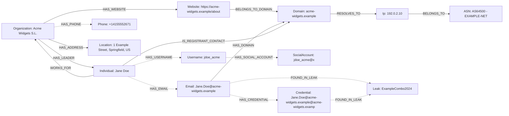

# Acme Widgets - ownership and infrastructure (example)

| Field | Value |
|---|---|
| Extraction id | acme-example-2026-11-04 |
| Created | 2026-11-04T16:30:20+00:00 |
| Agent | example-agent |
| Purpose | Map the people, accounts, and infrastructure behind acme-widgets.example for a due-diligence check. |
| Language | en |
| Ontology | flowsint-ontology 1.0.0 (Flowsint 39a977958e16) |
| Validation | valid; nodes checked by flowsint-pydantic, identity by flowsint |
| Files | `acme-example.flowsint.json`, `acme-example.graphql`, `acme-example.md` |

## Summary

Jane Doe is CFO of Acme Widgets S.L. and is the registrant of acme-widgets.example. The domain resolves to 192.0.2.10 in AS64500. The handle jdoe_acme on X probably belongs to her (one analyst statement, consistent naming). Her work e-mail appears in a 2024 combolist with a hashed password.

**Input:** Company web page, a registry PDF, an analyst chat, and a DNS/WHOIS tool finding. All names and values are fictional; domains and IPs use documentation ranges.

## At a glance

- **13** entities, **16** relationships, **4** sources.
- Entities by domain: actor 2, persona 2, contact 3, infrastructure 3, web 1, security 2
- Relationships by label: `BELONGS_TO` 1, `BELONGS_TO_DOMAIN` 1, `FOUND_IN_LEAK` 2, `HAS_ADDRESS` 1, `HAS_CREDENTIAL` 1, `HAS_DOMAIN` 1, `HAS_EMAIL` 1, `HAS_LEADER` 1, `HAS_PHONE` 1, `HAS_SOCIAL_ACCOUNT` 1, `HAS_USERNAME` 1, `HAS_WEBSITE` 1, `IS_REGISTRANT_CONTACT` 1, `RESOLVES_TO` 1, `WORKS_FOR` 1

## Graph

Dashed arrow: confidence below 0.7. 🔒: node holds sensitive fields.

## Entities

### actor

| Node | Type | Properties | Confidence | Sources |
|---|---|---|---|---|
| **Acme Widgets S.L.** `organization:Acme Widgets S.L.` | Organization | name=Acme Widgets S.L. | 0.96 (confirmed) | S1, S2 |
| **Jane Doe** `individual:Jane Doe` | Individual | first_name=Jane; last_name=Doe; full_name=Jane Doe; job_title=CFO | 0.9 (confirmed) | S2 |

### persona

| Node | Type | Properties | Confidence | Sources |
|---|---|---|---|---|
| **jdoe_acme** `username:jdoe_acme` | Username | value=jdoe_acme; platform=x | 0.6 (possible) | S3 |
| **jdoe_acme@x** `socialaccount:x\|jdoe_acme` | SocialAccount | id=jdoe_acme@x; username={"nodeLabel": "jdoe_acme", "value": "jdoe_acme"}; profile_url=https://x.example/jdoe_acme; platform=x | 0.6 (possible) | S3 |

### contact

| Node | Type | Properties | Confidence | Sources |
|---|---|---|---|---|
| **Jane.Doe@acme-widgets.example** `email:Jane.Doe@acme-widgets.example` | Email | email=Jane.Doe@acme-widgets.example | 0.6 (possible) | S1 |
| **+14155552671** `phone:+14155552671` | Phone | number=+14155552671 | 0.6 (possible) | S1 |
| **1 Example Street, Springfield, US** `location:1 Example Street` | Location | address=1 Example Street; city=Springfield; country=US; zip=00000 | 0.9 (confirmed) | S2 |

### infrastructure

| Node | Type | Properties | Confidence | Sources |
|---|---|---|---|---|
| **acme-widgets.example** `domain:acme-widgets.example` | Domain | domain=acme-widgets.example; root=true | 0.985 (confirmed) | S1, S4 |
| **192.0.2.10** `ip:192.0.2.10` | Ip | address=192.0.2.10 | 0.9 (confirmed) | S4 |
| **AS64500 - EXAMPLE-NET** `asn:AS64500` | ASN | asn_str=AS64500; number=64500; name=EXAMPLE-NET; cidrs=[] | 0.9 (confirmed) | S4 |

### web

| Node | Type | Properties | Confidence | Sources |
|---|---|---|---|---|
| **https://acme-widgets.example/about** `website:https://acme-widgets.example/about` | Website | url=https://acme-widgets.example/about; redirects=[]; active=false; technologies=[] | 0.9 (confirmed) | S1 |

### security

| Node | Type | Properties | Confidence | Sources |
|---|---|---|---|---|
| **ExampleCombo2024** `leak:ExampleCombo2024` | Leak | name=ExampleCombo2024 | 0.5 (possible) | S3 |
| **Jane.Doe@acme-widgets.example@acme-widgets.example webmail** `credential:Jane.Doe@acme-widgets.example` | Credential | username=Jane.Doe@acme-widgets.example; service=acme-widgets.example webmail; password_hash=(hashed/masked); hash_type=sha256 | 0.5 (possible) | S3 |

## Relationships

| Source | Relationship | Target | Properties | Confidence | Evidence |
|---|---|---|---|---|---|
| Jane Doe | `WORKS_FOR` | Acme Widgets S.L. | role=CFO; start_date=2021-03-01 | 0.9 (confirmed) | S2 (p.2, officers) |
| Acme Widgets S.L. | `HAS_LEADER` | Jane Doe |  | 0.9 (confirmed) | S2 (p.2, officers) |
| Jane Doe | `HAS_EMAIL` | Jane.Doe@acme-widgets.example |  | 0.6 (possible) | S1 (#team) |
| Acme Widgets S.L. | `HAS_PHONE` | +14155552671 |  | 0.6 (possible) | S1 (footer) |
| Acme Widgets S.L. | `HAS_ADDRESS` | 1 Example Street, Springfield, US |  | 0.9 (confirmed) | S2 (p.1, registered office) |
| Acme Widgets S.L. | `HAS_WEBSITE` | https://acme-widgets.example/about |  | 0.9 (confirmed) | S1 (page URL) |
| https://acme-widgets.example/about | `BELONGS_TO_DOMAIN` | acme-widgets.example |  | 0.85 (probable) | S1 (URL host) |
| Jane.Doe@acme-widgets.example | `HAS_DOMAIN` | acme-widgets.example |  | 0.85 (probable) | S1 (#team) |
| Jane Doe | `IS_REGISTRANT_CONTACT` | acme-widgets.example | date=2026-11-04 | 0.9 (confirmed) | S4 (whois: Registrant Name) |
| acme-widgets.example | `RESOLVES_TO` | 192.0.2.10 | date=2026-11-04 | 0.9 (confirmed) | S4 (dig A) |
| 192.0.2.10 | `BELONGS_TO` | AS64500 - EXAMPLE-NET |  | 0.9 (confirmed) | S4 (whois 192.0.2.10) |
| jdoe_acme | `HAS_SOCIAL_ACCOUNT` | jdoe_acme@x |  | 0.6 (possible) | S3 (message 14:02) |
| Jane Doe | `HAS_USERNAME` | jdoe_acme |  | 0.6 (possible) | S3 (message 14:02) |
| Jane.Doe@acme-widgets.example | `FOUND_IN_LEAK` *(ext)* | ExampleCombo2024 |  | 0.5 (possible) | S3 (message 14:05) |
| Jane.Doe@acme-widgets.example | `HAS_CREDENTIAL` *(ext)* | Jane.Doe@acme-widgets.example@acme-widgets.example webmail |  | 0.5 (possible) | S3 (message 14:05) |
| Jane.Doe@acme-widgets.example@acme-widgets.example webmail | `FOUND_IN_LEAK` *(ext)* | ExampleCombo2024 |  | 0.5 (possible) | S3 (message 14:05) |

*(ext)*: skill extension label (valid in Flowsint, not produced by its enrichers).

## Evidence log

| Claim | Source | Locator | Method | Quote |
|---|---|---|---|---|
| node Acme Widgets S.L. | S2 | p.1, header | stated | Acme Widgets S.L. |
| node Acme Widgets S.L. | S1 | #about | stated | Acme Widgets S.L. designs industrial widgets. |
| node Jane Doe | S2 | p.2, officers | stated | Jane Doe - Chief Financial Officer (since 2021-03-01) |
| node Jane.Doe@acme-widgets.example | S1 | #team | stated | Contact our CFO: Jane.Doe@ACME-WIDGETS.example |
| node +14155552671 | S1 | footer | stated | Tel. +1 (415) 555-2671 |
| node 1 Example Street, Springfield, US | S2 | p.1, registered office | stated | Registered office: 1 Example Street, Springfield 00000 |
| node https://acme-widgets.example/about | S1 | page URL | observed |  |
| node acme-widgets.example | S4 | whois query | observed |  |
| node acme-widgets.example | S1 | #team | derived | e-mail domain part |
| node 192.0.2.10 | S4 | dig A acme-widgets.example | observed | acme-widgets.example. 300 IN A 192.0.2.10 |
| node AS64500 - EXAMPLE-NET | S4 | whois 192.0.2.10 | observed | origin: AS64500 |
| node jdoe_acme | S3 | message 14:02 | stated | Jane posts as @jdoe_acme on X |
| node jdoe_acme@x | S3 | message 14:02 | stated |  |
| node ExampleCombo2024 | S3 | message 14:05 | stated | her work address is in the ExampleCombo2024 list |
| node Jane.Doe@acme-widgets.example@acme-widgets.example webmail | S3 | message 14:05 | stated |  |
| edge Jane Doe WORKS_FOR Acme Widgets S.L. | S2 | p.2, officers | stated | Jane Doe - Chief Financial Officer (since 2021-03-01) |
| edge Acme Widgets S.L. HAS_LEADER Jane Doe | S2 | p.2, officers | stated |  |
| edge Jane Doe HAS_EMAIL Jane.Doe@acme-widgets.example | S1 | #team | stated |  |
| edge Acme Widgets S.L. HAS_PHONE +14155552671 | S1 | footer | stated |  |
| edge Acme Widgets S.L. HAS_ADDRESS 1 Example Street, Springfield, US | S2 | p.1, registered office | stated |  |
| edge Acme Widgets S.L. HAS_WEBSITE https://acme-widgets.example/about | S1 | page URL | observed |  |
| edge https://acme-widgets.example/about BELONGS_TO_DOMAIN acme-widgets.example | S1 | URL host | derived |  |
| edge Jane.Doe@acme-widgets.example HAS_DOMAIN acme-widgets.example | S1 | #team | derived |  |
| edge Jane Doe IS_REGISTRANT_CONTACT acme-widgets.example | S4 | whois: Registrant Name | observed | Registrant Name: Jane Doe |
| edge acme-widgets.example RESOLVES_TO 192.0.2.10 | S4 | dig A | observed |  |
| edge 192.0.2.10 BELONGS_TO AS64500 - EXAMPLE-NET | S4 | whois 192.0.2.10 | observed |  |
| edge jdoe_acme HAS_SOCIAL_ACCOUNT jdoe_acme@x | S3 | message 14:02 | stated |  |
| edge Jane Doe HAS_USERNAME jdoe_acme | S3 | message 14:02 | stated |  |
| edge Jane.Doe@acme-widgets.example FOUND_IN_LEAK ExampleCombo2024 | S3 | message 14:05 | stated |  |
| edge Jane.Doe@acme-widgets.example HAS_CREDENTIAL Jane.Doe@acme-widgets.example@acme-widgets.example webmail | S3 | message 14:05 | stated |  |
| edge Jane.Doe@acme-widgets.example@acme-widgets.example webmail FOUND_IN_LEAK ExampleCombo2024 | S3 | message 14:05 | stated |  |

## Sources

| Id | Kind | Title | URI / reference | Reliability | Retrieved |
|---|---|---|---|---|---|
| S1 | web | Acme Widgets - About us | https://acme-widgets.example/about | C | 2026-11-04 |
| S2 | public_record | Commercial registry extract, Acme Widgets S.L. | file:registry-extract.pdf | A |  |
| S3 | conversation | Analyst chat, 2026-11-04 |  | C |  |
| S4 | tool_output | dig + whois run on acme-widgets.example |  | A | 2026-11-04T10:12:00Z |

## Sensitive data

Values are masked in this report; the JSON keeps them for import. Each must be stated in the input and needed by the purpose.

| Node | Field | Class | Value (masked) |
|---|---|---|---|
| `credential:Jane.Doe@acme-widgets.example` | password_hash | secret | (hashed/masked) |

## Gaps

- No independent confirmation that @jdoe_acme belongs to Jane Doe (single second-hand chat statement).
- WHOIS registrant e-mail is redacted; the registrant match rests on the name only.

## Open questions

- Is ExampleCombo2024 a repost of an older catalogued breach?

## Deliberately not recorded

- Plaintext password mentioned in the chat: secret: never recorded; only the hash given in the list is kept

## Validation

- Status: **valid**
- Node models: flowsint-pydantic; identity canonicalizers: flowsint
- flowsint-graph v1 JSON Schema: pass
- GraphQL mutation vs ontology SDL: pass
- Flowsint parse_graph_document (importer): pass

**Normalisations and notices**

- entities[2] (jane-email): email normalised 'Jane.Doe@ACME-WIDGETS.example' -> 'Jane.Doe@acme-widgets.example' (email_address)
- entities[6] (dom): domain normalised 'ACME-WIDGETS.example.' -> 'acme-widgets.example' (domain_idna)
- entities[9] (asn): asn_str normalised 'as64500' -> 'AS64500' (asn_as_form)
- entities[10] (handle): value normalised '@jdoe_acme' -> 'jdoe_acme' (username)
- domain:acme-widgets.example: 2 mentions merged (same canonical identity)
- relationships[1]: label 'LEADS' -> HAS_LEADER (endpoints swapped)

## Import into Flowsint

The `acme-example.flowsint.json` file follows the frozen `flowsint-graph` v1 contract (Flowsint import, planned `IMPORT-001`). Evidence travels as inert extensions. Limits: 500 nodes, 1,000 relationships, 5 MiB.
