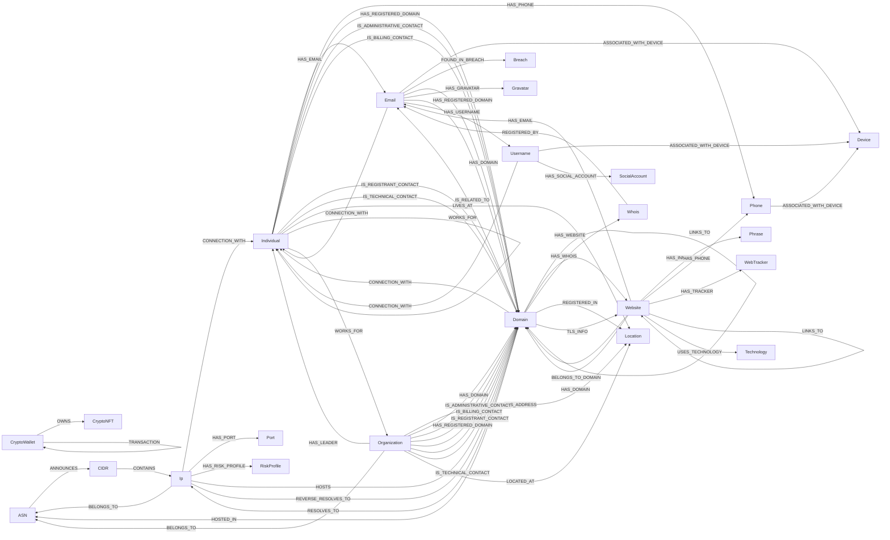

# Flowsint ontology: taxonomy and relationships

Ontology version **1.0.0**. Generated from Flowsint commit `39a977958e1650b7a6025938a0e34baaef4ba4cf` by `scripts/build_ontology.py`. Do not edit: change `ontology/curation.json` or the Flowsint source, then rebuild.

- Entity types: **40** (all registered Flowsint types)
- Relationship labels: **81** (44 native, 37 extension)
- Enrichers scanned: **50**; relationship calls: **109** (typed by name hint: 50, unresolved: 0)

Machine-readable twins: `flowsint-ontology.json` (complete data) and `flowsint-ontology.graphql` (SDL).

## 1. Sources of truth

| Fact | Source |
|---|---|
| types | `flowsint-types/src/flowsint_types/*.py` |
| categories | `flowsint-core/src/flowsint_core/core/services/type_registry_service.py` |
| identity | `flowsint-core/src/flowsint_core/imports/contracts/identity-config-v1.json` |
| graph_import_schema | `flowsint-core/src/flowsint_core/imports/contracts/flowsint-graph-v1.schema.json` |
| enrichers | `flowsint-enrichers/src/flowsint_enrichers` |
| curation | `ontology/curation.json (skill)` |

## 2. Conventions

- **node_type_in_json**: Lowercase registry key ("domain", "socialaccount"), as Flowsint stores nodeType and as native exports emit it. PascalCase class names ("Domain") are used in GraphQL and Markdown. Lookup is case-insensitive in Flowsint.
- **node_id**: Import-local id = <key>:<canonical identity>. The identity comes from the type's identity selector and canonicalizers (identity-config-v1). Composite selectors join values with '|'. Values longer than 96 characters, values with tabs, newlines, or other control characters, and identity values of sensitivity class secret, financial, or government_id use <key>:h:<first 16 hex of sha256(canonical)>. Never reuse one id for two different entities.
- **node_label**: The Flowsint compute_label() result. emit.py computes it with the real Pydantic model when a Flowsint interpreter is available; otherwise it falls back to the UI label_key, then the primary field.
- **properties**: Only fields of the Flowsint type, with their declared names. Flowsint types accept extra keys (extra=allow); emit.py keeps unknown keys and reports them. Never use reserved property names.
- **relationship_label**: UPPER_SNAKE_CASE verb phrase, read source -> target. Use a label from the relationship catalog. Prefer a native label when its definition fits. Use an extension label only when no native label fits. IS_RELATED_TO is the last resort and needs a caption that states the nature of the link.
- **relationship_direction**: Emit one direction only. Never emit a relationship and its inverse. For symmetric labels, order the endpoints by id.
- **relationship_properties**: Native edge properties are date, caption, type, weight, confidence_level. Put fact qualifiers (role, start_date, end_date, amount, currency) in properties as well; keep evidence in extensions.
- **nested_vs_edge**: Flowsint types can embed other types (Whois.domain, Individual.email_addresses). When an embedded entity matters to the investigation, also emit it as its own node and connect it with the matching relationship, as the enrichers do.
- **one_fact_one_edge**: Each relationship is one claim that can be true or false. Split compound sentences into several edges. Time-bound facts carry date or start_date/end_date.
- **uncertain_identity**: Two mentions that may denote the same entity are two nodes linked by POSSIBLY_SAME_AS with evidence. Never merge on a guess. Merge only when the canonical identity is equal.
- **default_label**: IS_RELATED_TO

Reserved property names (never use as fields): `id`, `x`, `y`, `nodeLabel`, `label`, `nodeType`, `type`, `nodeImage`, `nodeIcon`, `nodeColor`, `nodeSize`, `created_at`, `sketch_id`.

## 3. Taxonomy

Ten skill-level domains group the 40 Flowsint types. Flowsint's own UI categories follow the tree.

```text
Entity
├── actor — Actors
│   ├── Individual               identity: full_name
│   ├── Organization             identity: name
│   └── Affiliation              identity: organization
├── persona — Personas and digital identities
│   ├── Username                 identity: value
│   ├── SocialAccount            identity: platform + username.value
│   ├── Alias                    identity: alias
│   └── Gravatar                 identity: hash
├── contact — Contact points and places
│   ├── Email                    identity: email
│   ├── Phone                    identity: number
│   └── Location                 identity: address
├── infrastructure — Internet infrastructure
│   ├── Domain                   identity: domain
│   ├── Ip                       identity: address
│   ├── CIDR                     identity: network
│   ├── ASN                      identity: asn_str
│   ├── Port                     identity: number
│   ├── DNSRecord                identity: record_type + value
│   ├── SSLCertificate           identity: subject
│   └── Whois                    identity: domain.domain
├── web — Web presence
│   ├── Website                  identity: url
│   ├── WebTracker               identity: tracker_id
│   ├── Technology               identity: name
│   └── Script                   identity: script_id
├── security — Access and threat
│   ├── Credential               identity: username
│   ├── Session                  identity: session_id
│   ├── Device                   identity: device_id
│   ├── Malware                  identity: name
│   ├── Breach                   identity: name
│   └── Leak                     identity: name
├── content — Content and artefacts
│   ├── Document                 identity: title
│   ├── File                     identity: first present of hash_sha256 > hash_sha1 > hash_md5 > filename
│   ├── Message                  identity: message_id
│   └── Phrase                   identity: text
├── financial — Financial instruments and value transfer
│   ├── BankAccount              identity: account_number
│   ├── CreditCard               identity: card_number
│   ├── CryptoWallet             identity: address
│   ├── CryptoWalletTransaction  identity: hash
│   └── CryptoNFT                identity: contract_address + token_id
├── assessment — Analytic assessments
│   ├── RiskProfile              identity: entity_id
│   └── ReputationScore          identity: entity_id
└── physical — Physical objects
    └── Weapon                   identity: name
```

| Domain | Definition |
|---|---|
| `actor` | Persons and organisations that act, own, control, or employ; plus reified affiliations between them. |
| `persona` | Handles, accounts, and aliases through which an actor appears online. |
| `contact` | Selectors that reach or locate an actor: e-mail, phone, postal address or place. |
| `infrastructure` | Naming, addressing, routing, and registration of internet resources. |
| `web` | Websites and what they run or embed. |
| `security` | Authentication material, devices, sessions, malicious software, and exposure events. |
| `content` | Documents, files, messages, and free text that carry or mention facts. |
| `financial` | Accounts, cards, wallets, transactions, and tokens. |
| `assessment` | Scores and profiles that evaluate another entity. They are judgements, not observations. |
| `physical` | Tangible items of investigative interest. |

**Flowsint UI categories** (`TypeRegistryService._get_category_definitions`):

| Category | Types |
|---|---|
| Global | Phrase, Location |
| Identities & Entities | Individual, Username, Organization |
| Organization | Organization |
| Communication & Contact | Phone, Email, Username, SocialAccount, Message |
| Network | ASN, CIDR, Domain, Website, Ip, Port, DNSRecord, SSLCertificate, WebTracker |
| Security & Access | Credential, Session, Device, Malware, Weapon |
| Files & Documents | Document, File |
| Financial Data | BankAccount, CreditCard |
| Leaks | Leak |
| Crypto | CryptoWallet, CryptoWalletTransaction, CryptoNFT |
| Enrichment artifacts (registered, not in the UI picker) | Affiliation, Alias, Breach, Gravatar, ReputationScore, RiskProfile, Script, Technology, Whois |

## 4. Relationship catalog

Read every label **source → target**. `native` labels are produced by Flowsint enrichers (file:line evidence in the JSON). `extension` labels are this skill's vocabulary for facts no enricher produces; Flowsint stores any label string, so they import unchanged. Domain/range `*` means any type.

### generic

| Label | Status | Source types → Target types | Definition | Inverse reading |
|---|---|---|---|---|
| `IS_RELATED_TO` | native-default | * → * | Generic link whose nature no catalogued label expresses. Flowsint default label. *Last resort. Requires a caption that states the nature of the link; emit.py rejects it without one.* |  |

### affiliation

| Label | Status | Source types → Target types | Definition | Inverse reading |
|---|---|---|---|---|
| `AFFILIATION_WITH` | extension | Affiliation → Organization | The reified Affiliation is with the target organisation. |  |
| `ASSOCIATE_OF` | extension (symmetric) | Individual, Organization → Individual, Organization | The actors have a social or business association that no more precise label covers (partner, co-founder, co-defendant, frequent contact). Props: type, start_date, end_date. |  |
| `HAS_AFFILIATION` | extension | Individual → Affiliation | The person holds the reified Affiliation (role with its own dates and evidence). |  |
| `HAS_LEADER` | native | Organization → Individual | The organisation has the person as director, officer, executive, or legal representative. Props: role, start_date, end_date. | LEADS |
| `MEMBER_OF` | extension | Individual, Organization → Organization | The actor belongs to a group, association, party, board, or network, without an employment relation. Props: role, start_date, end_date. | HAS_MEMBER |
| `RELATIVE_OF` | extension (symmetric) | Individual → Individual | The persons are family members. Put the kind of kinship in properties.type (spouse, parent, sibling, child, ...); for directed kinship order source as the elder or the parent. |  |
| `SUBSIDIARY_OF` | extension | Organization → Organization | The organisation is owned or controlled by the target organisation (subsidiary, branch, front). Props: share_percent, start_date, end_date. | PARENT_OF |
| `WORKS_FOR` | native | Individual → Organization, Individual | The person is employed by, or works on behalf of, the target (organisation, or the person that WHOIS lists as the main contact). Props: role, start_date, end_date. | EMPLOYS |

### control

| Label | Status | Source types → Target types | Definition | Inverse reading |
|---|---|---|---|---|
| `CONTROLS` | extension | Individual, Organization → Organization, Domain, Website, SocialAccount, Username, Email, Phone, Device, Ip, CryptoWallet, BankAccount, Malware | The actor operates or administers the target without proven ownership (account operator, infrastructure administrator, nominee arrangement). | CONTROLLED_BY |
| `OWNS` | native | CryptoWallet, Individual, Organization → CryptoNFT, Organization, Domain, Website, CryptoWallet, BankAccount, CreditCard, Device, Phone, Email, Weapon, SocialAccount, Ip, CIDR, ASN | The source legally or beneficially owns the target. Native use: wallet owns NFT. Props: share_percent, start_date, end_date. *For operational control without proven ownership use CONTROLS.* | OWNED_BY |

### identity

| Label | Status | Source types → Target types | Definition | Inverse reading |
|---|---|---|---|---|
| `CONNECTION_WITH` | native | Domain, Email, Ip, Username, Phone → Individual | A breach or intelligence record links the selector to the person. Weak association, not proof of ownership. *Native in the dehashed and intelligence enrichers. Prefer HAS_EMAIL / HAS_PHONE / HAS_USERNAME (person as source) when a source states that the person uses the selector.* |  |
| `HAS_ALIAS` | extension | Individual, Organization, Username, SocialAccount → Alias | The source is also known by the alias. | ALIAS_OF |
| `HAS_GRAVATAR` | native | Email → Gravatar | The e-mail address has the Gravatar profile. |  |
| `HAS_SOCIAL_ACCOUNT` | native | Username, Individual, Organization → SocialAccount | The handle (or actor) has the account on a platform. | SOCIAL_ACCOUNT_OF |
| `HAS_USERNAME` | native | Email, Individual, Organization, Credential → Username | The source uses or exposes the handle. Native use: the local part of an e-mail as a candidate handle. | USERNAME_OF |
| `POSSIBLY_SAME_AS` | extension (symmetric) | * → * | Identity hypothesis: the two nodes may denote the same real-world entity. Both nodes stay separate until a human decides. *Both endpoints must have the same type. confidence_level states the strength of the hypothesis; evidence states the matching features.* |  |

### contact

| Label | Status | Source types → Target types | Definition | Inverse reading |
|---|---|---|---|---|
| `HAS_EMAIL` | native | Individual, Organization, Website, SocialAccount, Document → Email | The source uses, publishes, or is reachable at the e-mail address. | EMAIL_OF |
| `HAS_PHONE` | native | Individual, Organization, Website, SocialAccount, Document → Phone | The source uses, publishes, or is reachable at the phone number. | PHONE_OF |

### location

| Label | Status | Source types → Target types | Definition | Inverse reading |
|---|---|---|---|---|
| `HAS_ADDRESS` | native | Organization → Location | The organisation's registered or head-office address. |  |
| `LIVES_AT` | native | Individual → Location | The person resides or resided at the place. Props: start_date, end_date. |  |
| `LOCATED_AT` | native | Organization, Ip, Device, Weapon, Individual, Session, Message, File, Document → Location | The source is physically at the place (establishment, server geolocation, device position, item found). Native use: organisation establishment. Props: date, start_date, end_date. *For a person, use LIVES_AT for residence and LOCATED_AT with a date for presence at a time.* |  |
| `REGISTERED_IN` | native | Domain → Location | The domain's registrant is located at the place, according to WHOIS. |  |

### infrastructure

| Label | Status | Source types → Target types | Definition | Inverse reading |
|---|---|---|---|---|
| `ANNOUNCES` | native | ASN → CIDR | The autonomous system originates the IP prefix in BGP. Props: date. |  |
| `BELONGS_TO` | native | Ip, CIDR, Organization → ASN | The IP, prefix, or organisation belongs to the autonomous system (routing or operator relation). |  |
| `CERTIFICATE_COVERS` | extension | SSLCertificate → Domain | The certificate names the domain in its subject CN or SAN. |  |
| `CONTAINS` | native | CIDR, File, Document, Leak → Ip, CIDR, File, Document | The source contains the target: prefix contains address or sub-prefix; archive or document contains a file. Native use: CIDR contains IP. |  |
| `HAS_CERTIFICATE` | extension | Domain, Website, Ip → SSLCertificate | The host presents the X.509 certificate. Props: date. |  |
| `HAS_DNS_RECORD` | extension | Domain → DNSRecord | The domain has the DNS resource record. Props: date. |  |
| `HAS_DOMAIN` | native | Organization, Email, Website → Domain | The source is bound to the domain: registrant organisation, e-mail domain part, or website host. |  |
| `HAS_PORT` | native | Ip → Port | The IP exposes the port (open, filtered, or observed). Props: date. |  |
| `HAS_REGISTERED_DOMAIN` | native | Email, Individual, Organization → Domain | The actor or e-mail appears as registrant of the domain (reverse WHOIS). Props: date. |  |
| `HAS_RELATED_DOMAIN` | native | Domain → Domain | The domains share registrant data or history (reverse WHOIS, historical records). *Direction from the investigated domain to the discovered domain.* |  |
| `HAS_SUBDOMAIN` | native | Domain → Domain | The parent domain has the child hostname. | SUBDOMAIN_OF |
| `HAS_WHOIS` | native | Domain → Whois | The domain has the WHOIS registration record. |  |
| `HOSTED_IN` | native | Domain, Website → ASN | The domain's addresses are announced by the autonomous system. |  |
| `HOSTS` | native | Ip → Domain, Website | The IP serves the domain or website (passive DNS, reverse-IP, virtual hosting). Props: date, start_date, end_date. |  |
| `ISSUED_BY` | extension | SSLCertificate, CreditCard → Organization | The certificate or card was issued by the organisation (CA, card issuer). |  |
| `IS_ADMINISTRATIVE_CONTACT` | native | Individual, Organization → Domain | The actor is the administrative contact of the domain in WHOIS. Props: date. |  |
| `IS_BILLING_CONTACT` | native | Individual, Organization → Domain | The actor is the billing contact of the domain in WHOIS. Props: date. |  |
| `IS_REGISTRANT_CONTACT` | native | Individual, Organization → Domain | The actor is the registrant contact of the domain in WHOIS. Props: date. |  |
| `IS_TECHNICAL_CONTACT` | native | Individual, Organization → Domain | The actor is the technical contact of the domain in WHOIS. Props: date. |  |
| `POINTS_TO` | extension | DNSRecord → Ip, Domain | The DNS record's value designates the target (A/AAAA -> Ip; CNAME/NS/MX/PTR -> Domain). |  |
| `REGISTERED_BY` | native | Whois → Email, Individual, Organization | The WHOIS record names the target as registrant contact. |  |
| `RESOLVES_TO` | native | Domain → Ip | DNS A/AAAA resolution of the domain returns the IP. Props: date. |  |
| `REVERSE_RESOLVES_TO` | native | Ip → Domain | The IP's PTR record names the domain. Props: date. *Not a strict inverse of RESOLVES_TO: PTR and A records are independent. Emit the one actually observed.* |  |

### web

| Label | Status | Source types → Target types | Definition | Inverse reading |
|---|---|---|---|---|
| `BELONGS_TO_DOMAIN` | native | Website → Domain | The website's host is the domain. |  |
| `HAS_INNER_TEXT` | native | Website → Phrase | The website's visible text contains the phrase. |  |
| `HAS_SCRIPT` | extension | Website → Script | The website loads or embeds the script. |  |
| `HAS_TRACKER` | native | Website → WebTracker | The website embeds the tracker id. Props: date. |  |
| `HAS_WEBSITE` | native | Domain, Organization, Individual → Website | The domain serves the website. |  |
| `IS_SUBDOMAIN` | native | Website → Website | Native direction (website_to_subdomains): the parent website -> a website served on one of its subdomains. *The label reads backwards; keep the native direction. For Domain -> Domain use HAS_SUBDOMAIN.* |  |
| `LINKS_TO` | native | Website, Domain, Document, Message, SocialAccount → Website, Domain | The source contains a hyperlink to the target. Props: date. |  |
| `TLS_INFO` | native | Domain → Website | A TLS handshake on the domain produced the HTTPS website node that carries the certificate details (domain_to_tls). *Native only. For new certificate facts use HAS_CERTIFICATE -> SSLCertificate.* |  |
| `USES_TECHNOLOGY` | native | Website, Ip, Domain, Organization → Technology | The website or host runs the technology. Props: date. |  |

### security

| Label | Status | Source types → Target types | Definition | Inverse reading |
|---|---|---|---|---|
| `ASSOCIATED_WITH_DEVICE` | native | Email, Phone, Username, Individual, Credential, SocialAccount, Session → Device | The selector was found on, or used from, the device (infostealer logs). Native use: e-mail, phone, username. Props: date. |  |
| `COMMUNICATES_WITH` | extension | Malware, Device, Ip, File, Script → Ip, Domain, Website | The malware, device, or host makes network contact with the target (C2, beacon, exfiltration endpoint). Props: date, type. |  |
| `DISTRIBUTED_VIA` | extension | Malware, File, Script → Website, Domain, Message, SocialAccount | The malware or file is distributed through the website, domain, message, or account. Props: date. |  |
| `DROPS` | extension | Malware, Script, File → File, Script, Malware | The malware or script writes or downloads the file, script, or second-stage malware. |  |
| `FOUND_IN_BREACH` | native | Email, Username, Phone, Credential, CreditCard, BankAccount, Domain → Breach | The selector appears in the catalogued breach. Props: date. |  |
| `FOUND_IN_LEAK` | extension | Email, Username, Phone, Credential, CreditCard, BankAccount, Individual, Organization, Domain, Document, File → Leak | The selector or artefact appears in the leak or dump. Props: date. |  |
| `HAS_CREDENTIAL` | extension | Email, Username, Individual, SocialAccount, Phone → Credential | The selector or actor has the login credential. |  |
| `HAS_SESSION` | extension | Credential, Username, SocialAccount, Individual → Session | The credential or account opened the session. |  |
| `INFECTED` | extension | Malware → Device | The malware infected the device. Props: date. |  |
| `ORIGINATED_FROM` | extension | Session, Message, Credential → Ip, Device | The session, message, or connection came from the IP or device. Props: date. |  |
| `SAMPLE_OF` | extension | File, Script → Malware | The file or script is a sample of the malware family. |  |
| `USES_MALWARE` | extension | Individual, Organization → Malware | The actor deploys or operates the malware. Props: start_date, end_date. |  |

### communication

| Label | Status | Source types → Target types | Definition | Inverse reading |
|---|---|---|---|---|
| `HAS_ATTACHMENT` | extension | Message → File, Document | The message carries the file or document. |  |
| `REPLY_TO` | extension | Message → Message | The message replies to the earlier message. |  |
| `SENT` | extension | Email, Phone, Username, SocialAccount, Individual, Organization → Message | The sender (account, address, number, or actor) sent the message. Props: date. |  |
| `SENT_TO` | extension | Message → Email, Phone, Username, SocialAccount, Individual, Organization | The message was addressed to the recipient. Props: type. *properties.type = to \| cc \| bcc \| dm \| group.* |  |

### content

| Label | Status | Source types → Target types | Definition | Inverse reading |
|---|---|---|---|---|
| `AUTHORED` | extension | Individual, Organization, Username, SocialAccount → Document, Message, Script, File, Phrase, Website | The actor or account wrote or created the content. Props: date. |  |
| `MENTIONS` | extension | Document, Message, Website, Phrase, File, SocialAccount → * | The content names or refers to the entity without asserting a stronger relation. Props: date. *Use it to link a relevant source document to the entities it reports; use the specific label for the fact itself.* |  |
| `PUBLISHED_ON` | extension | Document, Message, File, Phrase, Script → Website, SocialAccount | The content was published at the website or account. Props: date. |  |

### financial

| Label | Status | Source types → Target types | Definition | Inverse reading |
|---|---|---|---|---|
| `HELD_AT` | extension | BankAccount, CreditCard, CryptoWallet → Organization | The account or card is held at the financial institution. |  |
| `SENT_TRANSACTION` | extension | CryptoWallet → CryptoWalletTransaction | The wallet is the sender of the reified transaction node. |  |
| `TRANSACTION` | native | CryptoWallet → CryptoWallet | On-chain transfer from the source wallet to the target wallet. Native: created by cryptowallet_to_transactions via create_wallet_transactions, merged on hash. Props: hash, value, timestamp, block_number, contract_address. *Put the transaction hash in properties.hash: Flowsint merges TRANSACTION edges on it.* |  |
| `TRANSACTION_TO` | extension | CryptoWalletTransaction → CryptoWallet | The reified transaction pays the target wallet. |  |
| `TRANSFERRED_TO` | extension | BankAccount, CreditCard, Individual, Organization, CryptoWallet → BankAccount, Individual, Organization, CryptoWallet | Off-chain value transfer (wire, card payment, cash) from the source to the target. Props: amount, currency, date, reference. *For on-chain transfers between wallets use the native TRANSACTION.* |  |

### assessment

| Label | Status | Source types → Target types | Definition | Inverse reading |
|---|---|---|---|---|
| `HAS_REPUTATION` | extension | * → ReputationScore | The entity has the reputation score from a provider. Props: date. |  |
| `HAS_RISK_PROFILE` | native | * → RiskProfile | The entity is assessed by the risk profile. Native use: IP fraud score. Props: date. |  |

### Accepted spellings

emit.py rewrites these spellings to the canonical label; `inverse` spellings also swap source and target.

| Spelling | Canonical | Kind |
|---|---|---|
| `ALIAS_OF` | `HAS_ALIAS` (swap endpoints) | inverse |
| `CEO_OF` | `HAS_LEADER` | synonym |
| `CONTROLLED_BY` | `CONTROLS` (swap endpoints) | inverse |
| `DIRECTOR_OF` | `HAS_LEADER` | synonym |
| `EMAIL_OF` | `HAS_EMAIL` (swap endpoints) | inverse |
| `EMPLOYED_BY` | `WORKS_FOR` | synonym |
| `EMPLOYEE_OF` | `WORKS_FOR` | synonym |
| `EMPLOYS` | `WORKS_FOR` (swap endpoints) | inverse |
| `HAS_MEMBER` | `MEMBER_OF` (swap endpoints) | inverse |
| `IS_RELATED_T0` | `IS_RELATED_TO` | alias |
| `LEADS` | `HAS_LEADER` (swap endpoints) | inverse |
| `OWNED_BY` | `OWNS` (swap endpoints) | inverse |
| `PARENT_OF` | `SUBSIDIARY_OF` (swap endpoints) | inverse |
| `PHONE_OF` | `HAS_PHONE` (swap endpoints) | inverse |
| `RELATED_TO` | `IS_RELATED_TO` | alias |
| `SOCIAL_ACCOUNT_OF` | `HAS_SOCIAL_ACCOUNT` (swap endpoints) | inverse |
| `SUBDOMAIN_OF` | `HAS_SUBDOMAIN` (swap endpoints) | inverse |
| `USERNAME_OF` | `HAS_USERNAME` (swap endpoints) | inverse |

## 5. Outgoing relationships by source type

Use this index to pick a label once the source node type is known.

| Source type | Labels (→ target types) |
|---|---|
| ASN | `ANNOUNCES`→CIDR |
| Affiliation | `AFFILIATION_WITH`→Organization |
| Alias | — |
| BankAccount | `FOUND_IN_BREACH`→Breach; `FOUND_IN_LEAK`→Leak; `HELD_AT`→Organization; `TRANSFERRED_TO`→BankAccount/Individual/Organization/CryptoWallet |
| Breach | — |
| CIDR | `BELONGS_TO`→ASN; `CONTAINS`→Ip/CIDR/File/Document |
| Credential | `ASSOCIATED_WITH_DEVICE`→Device; `FOUND_IN_BREACH`→Breach; `FOUND_IN_LEAK`→Leak; `HAS_SESSION`→Session; `HAS_USERNAME`→Username; `ORIGINATED_FROM`→Ip/Device |
| CreditCard | `FOUND_IN_BREACH`→Breach; `FOUND_IN_LEAK`→Leak; `HELD_AT`→Organization; `ISSUED_BY`→Organization; `TRANSFERRED_TO`→BankAccount/Individual/Organization/CryptoWallet |
| CryptoNFT | — |
| CryptoWallet | `HELD_AT`→Organization; `OWNS`→CryptoNFT/Organization/Domain/Website/CryptoWallet/BankAccount/CreditCard/Device/Phone/Email/Weapon/SocialAccount/Ip/CIDR/ASN; `SENT_TRANSACTION`→CryptoWalletTransaction; `TRANSACTION`→CryptoWallet; `TRANSFERRED_TO`→BankAccount/Individual/Organization/CryptoWallet |
| CryptoWalletTransaction | `TRANSACTION_TO`→CryptoWallet |
| DNSRecord | `POINTS_TO`→Ip/Domain |
| Device | `COMMUNICATES_WITH`→Ip/Domain/Website; `LOCATED_AT`→Location |
| Document | `CONTAINS`→Ip/CIDR/File/Document; `FOUND_IN_LEAK`→Leak; `HAS_EMAIL`→Email; `HAS_PHONE`→Phone; `LINKS_TO`→Website/Domain; `LOCATED_AT`→Location; `MENTIONS`→*; `PUBLISHED_ON`→Website/SocialAccount |
| Domain | `CONNECTION_WITH`→Individual; `FOUND_IN_BREACH`→Breach; `FOUND_IN_LEAK`→Leak; `HAS_CERTIFICATE`→SSLCertificate; `HAS_DNS_RECORD`→DNSRecord; `HAS_RELATED_DOMAIN`→Domain; `HAS_SUBDOMAIN`→Domain; `HAS_WEBSITE`→Website; `HAS_WHOIS`→Whois; `HOSTED_IN`→ASN; `LINKS_TO`→Website/Domain; `REGISTERED_IN`→Location; `RESOLVES_TO`→Ip; `TLS_INFO`→Website; `USES_TECHNOLOGY`→Technology |
| Email | `ASSOCIATED_WITH_DEVICE`→Device; `CONNECTION_WITH`→Individual; `FOUND_IN_BREACH`→Breach; `FOUND_IN_LEAK`→Leak; `HAS_CREDENTIAL`→Credential; `HAS_DOMAIN`→Domain; `HAS_GRAVATAR`→Gravatar; `HAS_REGISTERED_DOMAIN`→Domain; `HAS_USERNAME`→Username; `SENT`→Message |
| File | `COMMUNICATES_WITH`→Ip/Domain/Website; `CONTAINS`→Ip/CIDR/File/Document; `DISTRIBUTED_VIA`→Website/Domain/Message/SocialAccount; `DROPS`→File/Script/Malware; `FOUND_IN_LEAK`→Leak; `LOCATED_AT`→Location; `MENTIONS`→*; `PUBLISHED_ON`→Website/SocialAccount; `SAMPLE_OF`→Malware |
| Gravatar | — |
| Individual | `ASSOCIATED_WITH_DEVICE`→Device; `ASSOCIATE_OF`→Individual/Organization; `AUTHORED`→Document/Message/Script/File/Phrase/Website; `CONTROLS`→Organization/Domain/Website/SocialAccount/Username/Email/Phone/Device/Ip/CryptoWallet/BankAccount/Malware; `FOUND_IN_LEAK`→Leak; `HAS_AFFILIATION`→Affiliation; `HAS_ALIAS`→Alias; `HAS_CREDENTIAL`→Credential; `HAS_EMAIL`→Email; `HAS_PHONE`→Phone; `HAS_REGISTERED_DOMAIN`→Domain; `HAS_SESSION`→Session; `HAS_SOCIAL_ACCOUNT`→SocialAccount; `HAS_USERNAME`→Username; `HAS_WEBSITE`→Website; `IS_ADMINISTRATIVE_CONTACT`→Domain; `IS_BILLING_CONTACT`→Domain; `IS_REGISTRANT_CONTACT`→Domain; `IS_TECHNICAL_CONTACT`→Domain; `LIVES_AT`→Location; `LOCATED_AT`→Location; `MEMBER_OF`→Organization; `OWNS`→CryptoNFT/Organization/Domain/Website/CryptoWallet/BankAccount/CreditCard/Device/Phone/Email/Weapon/SocialAccount/Ip/CIDR/ASN; `RELATIVE_OF`→Individual; `SENT`→Message; `TRANSFERRED_TO`→BankAccount/Individual/Organization/CryptoWallet; `USES_MALWARE`→Malware; `WORKS_FOR`→Organization/Individual |
| Ip | `BELONGS_TO`→ASN; `COMMUNICATES_WITH`→Ip/Domain/Website; `CONNECTION_WITH`→Individual; `HAS_CERTIFICATE`→SSLCertificate; `HAS_PORT`→Port; `HOSTS`→Domain/Website; `LOCATED_AT`→Location; `REVERSE_RESOLVES_TO`→Domain; `USES_TECHNOLOGY`→Technology |
| Leak | `CONTAINS`→Ip/CIDR/File/Document |
| Location | — |
| Malware | `COMMUNICATES_WITH`→Ip/Domain/Website; `DISTRIBUTED_VIA`→Website/Domain/Message/SocialAccount; `DROPS`→File/Script/Malware; `INFECTED`→Device |
| Message | `HAS_ATTACHMENT`→File/Document; `LINKS_TO`→Website/Domain; `LOCATED_AT`→Location; `MENTIONS`→*; `ORIGINATED_FROM`→Ip/Device; `PUBLISHED_ON`→Website/SocialAccount; `REPLY_TO`→Message; `SENT_TO`→Email/Phone/Username/SocialAccount/Individual/Organization |
| Organization | `ASSOCIATE_OF`→Individual/Organization; `AUTHORED`→Document/Message/Script/File/Phrase/Website; `BELONGS_TO`→ASN; `CONTROLS`→Organization/Domain/Website/SocialAccount/Username/Email/Phone/Device/Ip/CryptoWallet/BankAccount/Malware; `FOUND_IN_LEAK`→Leak; `HAS_ADDRESS`→Location; `HAS_ALIAS`→Alias; `HAS_DOMAIN`→Domain; `HAS_EMAIL`→Email; `HAS_LEADER`→Individual; `HAS_PHONE`→Phone; `HAS_REGISTERED_DOMAIN`→Domain; `HAS_SOCIAL_ACCOUNT`→SocialAccount; `HAS_USERNAME`→Username; `HAS_WEBSITE`→Website; `IS_ADMINISTRATIVE_CONTACT`→Domain; `IS_BILLING_CONTACT`→Domain; `IS_REGISTRANT_CONTACT`→Domain; `IS_TECHNICAL_CONTACT`→Domain; `LOCATED_AT`→Location; `MEMBER_OF`→Organization; `OWNS`→CryptoNFT/Organization/Domain/Website/CryptoWallet/BankAccount/CreditCard/Device/Phone/Email/Weapon/SocialAccount/Ip/CIDR/ASN; `SENT`→Message; `SUBSIDIARY_OF`→Organization; `TRANSFERRED_TO`→BankAccount/Individual/Organization/CryptoWallet; `USES_MALWARE`→Malware; `USES_TECHNOLOGY`→Technology |
| Phone | `ASSOCIATED_WITH_DEVICE`→Device; `CONNECTION_WITH`→Individual; `FOUND_IN_BREACH`→Breach; `FOUND_IN_LEAK`→Leak; `HAS_CREDENTIAL`→Credential; `SENT`→Message |
| Phrase | `MENTIONS`→*; `PUBLISHED_ON`→Website/SocialAccount |
| Port | — |
| ReputationScore | — |
| RiskProfile | — |
| SSLCertificate | `CERTIFICATE_COVERS`→Domain; `ISSUED_BY`→Organization |
| Script | `COMMUNICATES_WITH`→Ip/Domain/Website; `DISTRIBUTED_VIA`→Website/Domain/Message/SocialAccount; `DROPS`→File/Script/Malware; `PUBLISHED_ON`→Website/SocialAccount; `SAMPLE_OF`→Malware |
| Session | `ASSOCIATED_WITH_DEVICE`→Device; `LOCATED_AT`→Location; `ORIGINATED_FROM`→Ip/Device |
| SocialAccount | `ASSOCIATED_WITH_DEVICE`→Device; `AUTHORED`→Document/Message/Script/File/Phrase/Website; `HAS_ALIAS`→Alias; `HAS_CREDENTIAL`→Credential; `HAS_EMAIL`→Email; `HAS_PHONE`→Phone; `HAS_SESSION`→Session; `LINKS_TO`→Website/Domain; `MENTIONS`→*; `SENT`→Message |
| Technology | — |
| Username | `ASSOCIATED_WITH_DEVICE`→Device; `AUTHORED`→Document/Message/Script/File/Phrase/Website; `CONNECTION_WITH`→Individual; `FOUND_IN_BREACH`→Breach; `FOUND_IN_LEAK`→Leak; `HAS_ALIAS`→Alias; `HAS_CREDENTIAL`→Credential; `HAS_SESSION`→Session; `HAS_SOCIAL_ACCOUNT`→SocialAccount; `SENT`→Message |
| Weapon | `LOCATED_AT`→Location |
| WebTracker | — |
| Website | `BELONGS_TO_DOMAIN`→Domain; `HAS_CERTIFICATE`→SSLCertificate; `HAS_DOMAIN`→Domain; `HAS_EMAIL`→Email; `HAS_INNER_TEXT`→Phrase; `HAS_PHONE`→Phone; `HAS_SCRIPT`→Script; `HAS_TRACKER`→WebTracker; `HOSTED_IN`→ASN; `IS_SUBDOMAIN`→Website; `LINKS_TO`→Website/Domain; `MENTIONS`→*; `USES_TECHNOLOGY`→Technology |
| Whois | `REGISTERED_BY`→Email/Individual/Organization |
| *any type* | `HAS_REPUTATION`→ReputationScore; `HAS_RISK_PROFILE`→RiskProfile; `IS_RELATED_TO`→*; `POSSIBLY_SAME_AS`→* |

## 6. Native relationship map (observed in Flowsint)



### Upstream anomalies

Observed in Flowsint but not to be reproduced:

- `Domain -IS_RELATED_TO-> Domain` (raw label `IS_RELATED_T0`) at `flowsint-enrichers/src/flowsint_enrichers/domain/to_dummy_individuals.py:54`: Upstream typo (digit zero) in the test-only domain_to_dummy enricher.
- `Individual -WORKS_FOR-> Email` at `flowsint-enrichers/src/flowsint_enrichers/email/to_domains.py:310`: Upstream emits Individual -WORKS_FOR-> Email. Semantically wrong: use Individual -HAS_EMAIL-> Email.

## 7. Entity catalog

Per type: description, identity rule, label rule, and every field. `!` = required by the Pydantic model; `★` = Flowsint primary field; sensitivity classes are defined in section 8.

### ASN

Represents an Autonomous System Number with associated network information.

- Key `asn` · domain `infrastructure` · UI categories: network
- Identity (all): `asn_str` (asn_as_form) — Numeric ASN identity; malformed or out-of-range values block before matching.
- Label key: `number` · auto-detect from text: yes
- Recognize: Autonomous system number (AS15169).
- Identity tip: asn_str in AS<digits> form.

| Field | Type | Description |
|---|---|---|
| `asn_str`★! | string | ASN in string format (e.g., 'AS15169') |
| `number` | integer | Autonomous System Number (e.g., 15169) |
| `name` | string | Name of the organization owning the ASN |
| `country` | string | ISO 3166-1 alpha-2 country code |
| `description` | string | Additional information about the ASN |
| `cidrs` | [CIDR] | List of announced CIDR blocks |

### Affiliation

Represents an organizational affiliation or employment relationship.

- Key `affiliation` · domain `actor` · UI categories: enrichment_artifacts
- Identity (all): `organization` (exact_string) — Role and dates do not participate in identity.
- Label key: `organization` · auto-detect from text: yes
- Recognize: A role of a person in an organisation that needs its own dates, department, or source.
- Identity tip: organization is the identity; prefer a WORKS_FOR / MEMBER_OF edge with role and dates unless the affiliation must carry its own evidence trail.
- Avoid: Do not duplicate a WORKS_FOR edge with an Affiliation node for the same fact.

| Field | Type | Description |
|---|---|---|
| `organization`★! | string | Organization or group name |
| `role` | string | Role or position within organization |
| `start_date` | string | Start date of affiliation |
| `end_date` | string | End date of affiliation |
| `is_current` | boolean | Whether affiliation is currently active |
| `department` | string | Department or division |
| `location` | string | Geographic location of affiliation |
| `industry` | string | Industry or sector |
| `description` | string | Description of affiliation |
| `source` | string | Source of affiliation information |
| `confidence` | number | Confidence score for affiliation |
| `associated_individuals` | [string] | Individuals with similar affiliations |
| `organization_type` | string | Type of organization (company, NGO, government, etc.) |
| `hierarchy_level` | string | Hierarchical level within organization |

### Alias

Represents an alias or alternative name used by an entity.

- Key `alias` · domain `persona` · UI categories: enrichment_artifacts
- Identity (all): `alias` (exact_string) — Alias type and context are deliberately excluded.
- Label key: `alias` · auto-detect from text: yes
- Recognize: Another name an actor uses: nickname, nom de guerre, trade name.
- Identity tip: alias string as written.
- Avoid: A handle on a platform is a Username, not an Alias.

| Field | Type | Description |
|---|---|---|
| `alias`★! | string | Alias or alternative name |
| `type` | string | Type of alias (nickname, code name, etc.) |
| `context` | string | Context where alias is used |
| `first_seen` | string | First time alias was observed |
| `last_seen` | string | Last time alias was observed |
| `confidence` | number | Confidence score for alias association |
| `source` | string | Source of alias information |
| `associated_entities` | [string] | Entities associated with this alias |
| `description` | string | Description or notes about the alias |
| `is_active` | boolean | Whether alias is currently active |
| `language` | string | Language of the alias |
| `region` | string | Geographic region where alias is used |

### BankAccount

Represents a bank account with financial and security information.

- Key `bankaccount` · domain `financial` · UI categories: financial
- Identity (all): `account_number` (exact_string) — No separator removal is safe without a country- and bank-specific standard.
- Label key: `account_number` · auto-detect from text: yes
- Recognize: Bank account (IBAN, account number).
- Identity tip: account_number exactly as written (no separator removal).

| Field | Type | Description |
|---|---|---|
| `account_number`★! | string | Bank account number **[financial]** |
| `bank_name` | string | Bank name |
| `account_type` | string | Type of account (checking, savings, etc.) |
| `routing_number` | string | Bank routing number **[financial]** |
| `iban` | string | International Bank Account Number **[financial]** |
| `swift_code` | string | SWIFT/BIC code |
| `country` | string | Country where account is held |
| `currency` | string | Account currency |
| `balance` | number | Account balance **[financial]** |
| `account_holder` | string | Account holder name |
| `status` | string | Account status (active, closed, etc.) |
| `opened_date` | string | Account opening date |
| `closed_date` | string | Account closing date |
| `is_joint` | boolean | Whether account is joint |
| `associated_individuals` | [string] | Individuals associated with account |
| `source` | string | Source of account information |
| `is_compromised` | boolean | Whether account has been compromised |
| `breach_source` | string | Source of breach if compromised |

### Breach

Represents a data breach incident with affected accounts and details.

- Key `breach` · domain `security` · UI categories: enrichment_artifacts
- Identity (all): `name` (exact_string) — Breach display title and domain are not identity fields.
- Label key: `name` · auto-detect from text: yes
- Recognize: A named data breach (HIBP-style).
- Identity tip: name.

| Field | Type | Description |
|---|---|---|
| `name`★! | string | The name of the breach or service |
| `title` | string | Title of the breach |
| `domain` | string | Domain of the breached service |
| `breachdate` | string | Date of the breach |
| `addeddate` | string | Date breach was added to HIBP |
| `modifieddate` | string | Date breach was last modified |
| `pwncount` | integer | Number of accounts affected |
| `description` | string | Description of the breach |
| `logopath` | string | Logo path for the breach |
| `dataclasses` | [string] | Types of data compromised |
| `isverified` | boolean | Whether the breach is verified |
| `isfabricated` | boolean | Whether the breach is fabricated |
| `issensitive` | boolean | Whether the breach is sensitive |
| `isretired` | boolean | Whether the breach is retired |
| `isspamlist` | boolean | Whether the breach is a spam list |
| `ismalware` | boolean | Whether the breach is related to malware |
| `isstealerlog` | boolean | Whether the breach is a stealer log |
| `issubscriptionfree` | boolean | Whether the breach is subscription free |
| `breach` | object | Full breach data as returned by the API |

### CIDR

Represents a CIDR (Classless Inter-Domain Routing) network block.

- Key `cidr` · domain `infrastructure` · UI categories: network
- Identity (all): `network` (cidr_network) — Host bits are masked with strict=false before matching.
- Label key: `network` · auto-detect from text: yes
- Recognize: IP prefix (192.0.2.0/24).
- Identity tip: network address with host bits masked.

| Field | Type | Description |
|---|---|---|
| `network`★! | string(ipvanynetwork) | CIDR block (e.g., 8.8.8.0/24) |

### Credential

Represents user credentials with compromise and usage information.

- Key `credential` · domain `security` · UI categories: security
- Identity (all): `username` (username) — Service is not included because the registered model marks only username as primary.
- Label key: `username` · auto-detect from text: yes
- Recognize: Login material tied to a service.
- Identity tip: username; service = the system it logs into (domain or app), omitted when unknown. The leak it came from is a Leak node via FOUND_IN_LEAK.
- Avoid: Never store a plaintext password and never hash one yourself; keep password_hash only when the source gives a hash.

| Field | Type | Description |
|---|---|---|
| `username`★! | string | Username or identifier |
| `service` | string | Service or platform where credential is used |
| `type` | string | Type of credential (password, token, key, etc.) |
| `first_seen` | string | First time credential was observed |
| `last_seen` | string | Last time credential was observed |
| `is_active` | boolean | Whether credential is currently active |
| `is_compromised` | boolean | Whether credential has been compromised |
| `breach_source` | string | Source of breach if compromised |
| `password_hash` | string | Hashed password (if available) **[secret]** |
| `hash_type` | string | Type of hash algorithm used |
| `associated_emails` | [string] | Associated email addresses |
| `associated_phones` | [string] | Associated phone numbers |
| `ip_addresses` | [string] | IP addresses used with credential |
| `user_agents` | [string] | User agents used with credential |
| `locations` | [string] | Geographic locations where credential was used |
| `description` | string | Additional notes about credential |
| `source` | string | Source of credential information |

### CreditCard

Represents a credit card with financial details and security status.

- Key `creditcard` · domain `financial` · UI categories: financial
- Identity (all): `card_number` (credit_card_digits) — Only ASCII digits participate after separator removal.
- Label key: `card_number` · auto-detect from text: yes
- Recognize: Payment card number.
- Identity tip: digits only. Never store CVV.

| Field | Type | Description |
|---|---|---|
| `card_number`★! | string | Credit card number **[financial]** |
| `card_type` | string | Type of card (Visa, Mastercard, etc.) |
| `issuer` | string | Card issuer bank |
| `expiry_date` | string | Card expiry date **[financial]** |
| `cvv` | string | Card verification value **[secret]** |
| `cardholder_name` | string | Cardholder name |
| `billing_address` | string | Billing address |
| `credit_limit` | number | Credit limit **[financial]** |
| `available_credit` | number | Available credit **[financial]** |
| `status` | string | Card status (active, suspended, etc.) |
| `issued_date` | string | Card issue date |
| `is_virtual` | boolean | Whether card is virtual |
| `is_prepaid` | boolean | Whether card is prepaid |
| `is_business` | boolean | Whether card is business card |
| `associated_accounts` | [string] | Associated bank accounts |
| `source` | string | Source of card information |
| `is_compromised` | boolean | Whether card has been compromised |
| `breach_source` | string | Source of breach if compromised |
| `last_used` | string | Last time card was used |

### CryptoNFT

Represents a Non-Fungible Token (NFT) held or minted by a wallet.

- Key `cryptonft` · domain `financial` · UI categories: crypto
- Identity (all): `contract_address` (ethereum_address), `token_id` (exact_string) — Composite identity overrides the model's token_id-only primary marker to prevent cross-contract collisions.
- Label key: `name` · auto-detect from text: no
- Recognize: A non-fungible token.
- Identity tip: contract_address + token_id; wallet required by the type.

| Field | Type | Description |
|---|---|---|
| `wallet`! | CryptoWallet | Source wallet |
| `contract_address`! | string | Address of the NFT smart contract (ERC-721/1155) |
| `token_id`★! | string | Unique token ID of the NFT within the contract |
| `collection_name` | string | Name of the NFT collection |
| `metadata_url` | string(uri) | URL to the metadata JSON or IPFS resource |
| `image_url` | string(uri) | URL to the image or media representing the NFT |
| `name` | string | Name or title of the NFT |
| `description` | string | Text description of the NFT |
| `owner_address` | string | Current owner of the NFT |
| `creator_address` | string | Original minter or creator address |
| `last_transfer_date` | string | Date of last transfer or update (ISO format) |
| `node_id` | string | NFT node ID in the Explorer graph |

### CryptoWallet

Represents a cryptocurrency wallet.

- Key `cryptowallet` · domain `financial` · UI categories: crypto
- Identity (all): `address` (crypto_address) — Universal crypto-address lowercasing is forbidden.
- Label key: `address` · auto-detect from text: yes
- Recognize: Blockchain address.
- Identity tip: lowercase Ethereum (0x...) only; keep the case of other chains.

| Field | Type | Description |
|---|---|---|
| `address`★! | string | Wallet address |
| `node_id` | string | Wallet Explorer node ID |

### CryptoWalletTransaction

Represents a cryptocurrency transaction.

- Key `cryptowallettransaction` · domain `financial` · UI categories: crypto
- Identity (all): `hash` (hash_lower) — A missing transaction hash is a blocking unsupported identity form; source/target are not fallback identity.
- Label key: `hash` · auto-detect from text: no
- Recognize: An on-chain transaction.
- Identity tip: hash (lowercase); source wallet is required by the type.

| Field | Type | Description |
|---|---|---|
| `source`! | CryptoWallet | Source wallet |
| `target` | CryptoWallet | Target wallet |
| `hash`★ | string | Transaction hash |
| `value` | number | Transaction value in cryptocurrency |
| `amount` | number | Transaction amount in cryptocurrency |
| `amount_usd` | number | Transaction amount in USD |
| `date` | string | Transaction date |
| `hop` | integer | Hop distance from original wallet |
| `timestamp` | string | Transaction timestamp (unix epoch) |
| `block_number` | integer | Block number |
| `block_hash` | string | Block hash |
| `nonce` | integer | Transaction nonce |
| `transaction_index` | integer | Transaction index in block |
| `gas` | integer | Gas provided |
| `gas_price` | integer | Gas price in wei |
| `gas_used` | integer | Gas used |
| `cumulative_gas_used` | integer | Cumulative gas used |
| `input` | string | Input data |
| `contract_address` | string | Contract address |
| `method_id` | string | Method ID |
| `function_name` | string | Function name |
| `confirmations` | integer | Number of confirmations |
| `is_error` | boolean | Whether the transaction resulted in an error |
| `txreceipt_status` | string | Transaction receipt status |
| `error_message` | string | Error message if transaction failed |

### DNSRecord

Represents a DNS record with type, value, and security information.

- Key `dnsrecord` · domain `infrastructure` · UI categories: network
- Identity (all): `record_type` (exact_string), `value` (dns_value) — dns_value receives the canonical sibling record_type; unsupported structured values block.
- Label key: `name` · auto-detect from text: yes
- Recognize: A specific DNS resource record.
- Identity tip: record_type + value.

| Field | Type | Description |
|---|---|---|
| `value`★! | string | Record value |
| `record_type`! | string | Type of DNS record (A, AAAA, CNAME, MX, etc.) |
| `ttl` | integer | Time to live in seconds |
| `priority` | integer | Priority for MX records |
| `first_seen` | string | First time record was observed |
| `last_seen` | string | Last time record was observed |
| `is_active` | boolean | Whether record is currently active |
| `nameserver` | string | Nameserver that provided the record |
| `source` | string | Source of DNS information |
| `associated_domains` | [string] | Related domain names |
| `description` | string | Additional notes about the record |
| `is_suspicious` | boolean | Whether record is suspicious |
| `malware_family` | string | Malware family if record is malicious |
| `threat_level` | string | Threat level assessment |

### Device

Represents a device with hardware, software, and network information.

- Key `device` · domain `security` · UI categories: security
- Identity (all): `device_id` (exact_string) — Hardware identifiers are not reformatted without a field-specific syntax contract.
- Label key: `device_id` · auto-detect from text: yes
- Recognize: Phone, computer, IoT device, or browser fingerprint.
- Identity tip: device_id (IMEI, serial, hardware id, stealer-log machine id).

| Field | Type | Description |
|---|---|---|
| `device_id`★! | string | Unique device identifier |
| `type` | string | Type of device (mobile, desktop, server, etc.) |
| `manufacturer` | string | Device manufacturer |
| `model` | string | Device model |
| `os` | string | Operating system |
| `os_version` | string | Operating system version |
| `browser` | string | Browser used |
| `browser_version` | string | Browser version |
| `screen_resolution` | string | Screen resolution |
| `user_agent` | string | User agent string |
| `mac_address` | string | MAC address |
| `ip_addresses` | [string] | IP addresses associated with device |
| `first_seen` | string | First time device was observed |
| `last_seen` | string | Last time device was observed |
| `location` | string | Geographic location |
| `is_mobile` | boolean | Whether device is mobile |
| `is_tablet` | boolean | Whether device is a tablet |
| `is_desktop` | boolean | Whether device is a desktop |
| `associated_users` | [string] | Users associated with device |
| `source` | string | Source of device information |

### Document

Represents a document with metadata, security, and content information.

- Key `document` · domain `content` · UI categories: files
- Identity (all): `title` (exact_string) — Current primary field is title; hashes remain non-identity metadata for this type.
- Label key: `title` · auto-detect from text: yes
- Recognize: A document with title (report, PDF, contract, article).
- Identity tip: title; hashes and source_url in properties.
- Avoid: The analysed input itself becomes a Document node only when it matters to the investigation.

| Field | Type | Description |
|---|---|---|
| `title`★! | string | Document title |
| `doc_type` | string | Type of document (PDF, DOC, etc.) |
| `file_size` | integer | File size in bytes |
| `created_date` | string | Document creation date |
| `modified_date` | string | Document last modified date |
| `author` | string | Document author |
| `subject` | string | Document subject |
| `keywords` | [string] | Document keywords |
| `language` | string | Document language |
| `page_count` | integer | Number of pages |
| `hash_md5` | string | MD5 hash |
| `hash_sha1` | string | SHA1 hash |
| `hash_sha256` | string | SHA256 hash |
| `source_url` | string | Source URL if downloaded |
| `location` | string | File location or path |
| `is_encrypted` | boolean | Whether document is encrypted |
| `is_password_protected` | boolean | Whether document is password protected |
| `description` | string | Document description |
| `source` | string | Source of document information |

### Domain

Represents a domain name and its properties.

- Key `domain` · domain `infrastructure` · UI categories: network
- Identity (all): `domain` (domain_idna) — One trailing DNS root dot is removed.
- Label key: `domain` · auto-detect from text: yes
- Recognize: Registrable domain or hostname.
- Identity tip: lowercase IDNA A-label, no trailing dot; root=true for the registrable domain.
- Avoid: A URL is a Website; derive its Domain with BELONGS_TO_DOMAIN.

| Field | Type | Description |
|---|---|---|
| `domain`★! | string | Domain name |
| `root` | boolean | Is root or not |

### Email

Represents an email address.

- Key `email` · domain `contact` · UI categories: contact
- Identity (all): `email` (email_address) — The local part is never universally lowercased.
- Label key: `email` · auto-detect from text: yes
- Recognize: RFC 5322 addr-spec.
- Identity tip: preserve local-part case; domain lowercased IDNA.
- Avoid: Obfuscated forms ("jdoe [at] example [dot] com") must be de-obfuscated, with method=derived.

| Field | Type | Description |
|---|---|---|
| `email`★! | string(email) | Email address |

### File

Represents a file with metadata, type information, and security assessment.

- Key `file` · domain `content` · UI categories: files
- Identity (first_present): `hash_sha256` (hash_lower), `hash_sha1` (hash_lower), `hash_md5` (hash_lower), `filename` (exact_string) — Select the strongest present hash in SHA-256, SHA-1, MD5 order. Filename fallback risks collisions across unrelated files and every resulting match still requires human resolution.
- Label key: `filename` · auto-detect from text: yes
- Recognize: A file seen on disk or in transit.
- Identity tip: sha256 > sha1 > md5 > filename (first present).

| Field | Type | Description |
|---|---|---|
| `filename`★! | string | File name |
| `file_type` | string | File type or extension |
| `file_size` | integer | File size in bytes |
| `created_date` | string | File creation date |
| `modified_date` | string | File last modified date |
| `accessed_date` | string | File last accessed date |
| `path` | string | File path |
| `hash_md5` | string | MD5 hash |
| `hash_sha1` | string | SHA1 hash |
| `hash_sha256` | string | SHA256 hash |
| `is_executable` | boolean | Whether file is executable |
| `is_archive` | boolean | Whether file is an archive |
| `is_image` | boolean | Whether file is an image |
| `is_video` | boolean | Whether file is a video |
| `is_audio` | boolean | Whether file is an audio file |
| `is_text` | boolean | Whether file is a text file |
| `mime_type` | string | MIME type |
| `description` | string | File description |
| `source` | string | Source of file information |
| `is_malicious` | boolean | Whether file is malicious |
| `malware_family` | string | Malware family if malicious |
| `threat_level` | string | Threat level assessment |

### Gravatar

Represents a Gravatar profile with image and user information.

- Key `gravatar` · domain `persona` · UI categories: enrichment_artifacts
- Identity (all): `hash` (hash_lower) — Image URL does not participate in identity.
- Label key: `hash` · auto-detect from text: yes
- Recognize: Gravatar profile tied to an e-mail hash.
- Identity tip: hash (lowercase md5/sha256 of the e-mail).

| Field | Type | Description |
|---|---|---|
| `src`! | string(uri) | Gravatar image URL |
| `hash`★! | string | Gravatar hash |
| `size` | integer | Image size in pixels |
| `rating` | string | Content rating (g, pg, r, x) |
| `default_image` | string | Default image type when no gravatar exists |
| `force_default` | boolean | Whether to force default image |
| `exists` | boolean | Whether the gravatar exists |
| `profile_url` | string(uri) | URL to the Gravatar profile page |
| `display_name` | string | Display name from Gravatar profile |
| `location` | string | Location from Gravatar profile |
| `about_me` | string | Bio/about me text from Gravatar profile |
| `thumbnail_url` | string(uri) | Smaller version of the image |
| `large_url` | string(uri) | Larger version of the image |

### Individual

Represents an individual person with comprehensive personal information.

- Key `individual` · domain `actor` · UI categories: person_category
- Identity (all): `full_name` (individual_name) — Missing full_name is blocking for identity matching; first_name and last_name are not silently substituted.
- Label key: `full_name` · auto-detect from text: yes
- Recognize: A named natural person.
- Identity tip: full_name is the identity; set it even when only first_name/last_name are known ("Jane Doe").
- Avoid: Do not create an Individual from a bare handle; use Username.

| Field | Type | Description |
|---|---|---|
| `first_name` | string | First name of the individual |
| `last_name` | string | Last name of the individual |
| `full_name`★ | string | Full name of the individual |
| `middle_name` | string | Middle name or initial |
| `maiden_name` | string | Maiden name (if applicable) |
| `aliases` | [string] | Known aliases or nicknames |
| `birth_date` | string | Date of birth |
| `birth_place` | Location | Place of birth |
| `age` | integer | Current age |
| `gender` | enum(male, female, other) | Gender of the individual |
| `height` | string | Height (e.g., '5ft 10in' or '178cm') |
| `weight` | string | Weight (e.g., '170lbs' or '77kg') |
| `eye_color` | enum(brown, blue, green, hazel, gray, amber, other) | Eye color |
| `hair_color` | enum(black, brown, blonde, red, gray, white, bald, other) | Hair color |
| `skin_tone` | string | Skin tone description **[special_category]** |
| `ethnicity` | string | Ethnicity or ethnic background **[special_category]** |
| `blood_type` | enum(A+, A-, B+, B-, AB+, AB-, O+, O-) | Blood type **[special_category]** |
| `distinguishing_marks` | [string] | Distinguishing marks, scars, tattoos, etc. |
| `disabilities` | [string] | Known disabilities or medical conditions **[special_category]** |
| `is_smoker` | boolean | Whether the individual smokes **[special_category]** |
| `is_deceased` | boolean | Whether the individual is deceased |
| `death_date` | string | Date of death (if applicable) |
| `death_place` | Location | Place of death (if applicable) |
| `cause_of_death` | string | Cause of death (if applicable) **[special_category]** |
| `phone_numbers` | [Phone] | Known phone numbers |
| `email_addresses` | [Email] | Known email addresses |
| `social_media_profiles` | [string] | Social media profile URLs or usernames |
| `current_address` | Location | Current residential address |
| `previous_addresses` | [Location] | Previous known addresses |
| `nationality` | string | Nationality or country of citizenship |
| `citizenship` | [string] | Countries of citizenship (dual citizenship possible) |
| `place_of_residence` | string | Current place of residence (city/state/country) |
| `passport_number` | string | Passport number **[government_id]** |
| `drivers_license` | string | Driver's license number **[government_id]** |
| `social_security_number` | string | Social Security Number (SSN) **[government_id]** |
| `national_id` | string | National ID number **[government_id]** |
| `voter_id` | string | Voter ID number **[government_id]** |
| `tax_id` | string | Tax identification number **[government_id]** |
| `marital_status` | enum(single, married, divorced, widowed, separated, domestic_partnership) | Marital status |
| `spouse_name` | string | Name of spouse or partner |
| `children_count` | integer | Number of children |
| `children_names` | [string] | Names of children |
| `parents_names` | [string] | Names of parents |
| `emergency_contact` | string | Emergency contact information |
| `occupation` | string | Current occupation or job title |
| `employer` | string | Current employer |
| `employer_address` | Location | Employer's address |
| `job_title` | string | Current job title or position |
| `annual_income` | number | Annual income **[financial]** |
| `employment_history` | [string] | Previous employment history |
| `education_level` | enum(elementary, high_school, bachelor, master, doctorate, other) | Highest education level achieved |
| `schools_attended` | [string] | Schools or universities attended |
| `degrees` | [string] | Degrees or certifications obtained |
| `languages_spoken` | [string] | Languages spoken |
| `religion` | string | Religious affiliation **[special_category]** |
| `political_affiliation` | string | Political party affiliation **[special_category]** |
| `hobbies` | [string] | Known hobbies or interests |
| `personality_traits` | [string] | Known personality traits |
| `fingerprints` | string | Fingerprint data or hash **[special_category]** |
| `dna_profile` | string | DNA profile or hash **[special_category]** |
| `facial_recognition_id` | string | Facial recognition system ID **[special_category]** |
| `iris_scan` | string | Iris scan data or hash **[special_category]** |
| `voice_print` | string | Voice print data or hash **[special_category]** |
| `bank_accounts` | [string] | Known bank account numbers **[financial]** |
| `credit_score` | integer | Credit score **[financial]** |
| `net_worth` | number | Estimated net worth **[financial]** |
| `assets` | [string] | Known assets (property, vehicles, etc.) |
| `criminal_record` | boolean | Whether individual has a criminal record **[special_category]** |
| `arrest_history` | [string] | Known arrests or charges **[special_category]** |
| `convictions` | [string] | Criminal convictions **[special_category]** |
| `civil_cases` | [string] | Civil court cases |
| `security_clearance` | string | Security clearance level |
| `ip_addresses` | [Ip] | Known IP addresses |
| `usernames` | [string] | Known online usernames |
| `device_ids` | [string] | Known device identifiers |
| `first_seen` | string | First time individual was observed in system |
| `last_seen` | string | Last time individual was observed in system |
| `source` | string | Source of individual information |
| `confidence` | number | Confidence score for individual data |
| `notes` | string | Additional notes or observations |
| `src` | string | URL to profile picture |
| `last_updated` | string | Last update timestamp |

### Ip

Represents an IP address with geolocation and ISP information.

- Key `ip` · domain `infrastructure` · UI categories: network
- Identity (all): `address` (ip_compressed) — IPv4 and IPv6 are parsed, not compared as presentation strings.
- Label key: `address` · auto-detect from text: yes
- Recognize: IPv4 or IPv6 address.
- Identity tip: compressed canonical form.
- Avoid: Defanged forms (1.2.3[.]4) are re-fanged with method=derived.

| Field | Type | Description |
|---|---|---|
| `address`★! | string | IP address |
| `latitude` | number | Latitude coordinate of the IP location |
| `longitude` | number | Longitude coordinate of the IP location |
| `country` | string | Country where the IP is located |
| `city` | string | City where the IP is located |
| `isp` | string | Internet Service Provider |

### Leak

Represents a data leak or breach with associated data.

- Key `leak` · domain `security` · UI categories: leaks
- Identity (all): `name` (exact_string) — Nested leak data does not participate in identity.
- Label key: `name` · auto-detect from text: yes
- Recognize: A leak or dump that is not a catalogued breach (paste, combolist, internal leak).
- Identity tip: name.

| Field | Type | Description |
|---|---|---|
| `name`★! | string | The name of the leak or service brea |
| `leak` | [object] | List of data leaks found |

### Location

Represents a physical address with geographical coordinates.

- Key `location` · domain `contact` · UI categories: global_category
- Identity (all): `address` (exact_string) — Only the registered primary address field participates; city, country, and postal code remain properties.
- Label key: `address` · auto-detect from text: yes
- Recognize: Postal address or named place.
- Identity tip: address, city, country, and zip are all required by the type; use "unknown" only when the source lacks the part and say so in a gap.
- Avoid: Do not invent coordinates.

| Field | Type | Description |
|---|---|---|
| `address`★! | string | Street address |
| `city`! | string | City name |
| `country`! | string | Country name |
| `zip`! | string | ZIP or postal code |
| `latitude` | number | Latitude coordinate of the address |
| `longitude` | number | Longitude coordinate of the address |

### Malware

Represents malware with family, capabilities, and threat intelligence.

- Key `malware` · domain `security` · UI categories: security
- Identity (all): `name` (exact_string) — Family is deliberately excluded from the current identity selector.
- Label key: `name` · auto-detect from text: yes
- Recognize: Malware family or sample name.
- Identity tip: name; family as property; sample hashes in sample_hashes or as File nodes.

| Field | Type | Description |
|---|---|---|
| `name`★! | string | Malware name or identifier |
| `family` | string | Malware family |
| `type` | string | Type of malware (trojan, ransomware, etc.) |
| `description` | string | Malware description |
| `first_seen` | string | First time malware was observed |
| `last_seen` | string | Last time malware was observed |
| `is_active` | boolean | Whether malware is currently active |
| `threat_level` | string | Threat level assessment |
| `targets` | [string] | Target platforms or systems |
| `capabilities` | [string] | Malware capabilities |
| `indicators` | [string] | IOCs (Indicators of Compromise) |
| `c2_servers` | [string] | Command and control servers |
| `distribution_methods` | [string] | Distribution methods |
| `evasion_techniques` | [string] | Evasion techniques used |
| `persistence_mechanisms` | [string] | Persistence mechanisms |
| `encryption_methods` | [string] | Encryption methods used |
| `source` | string | Source of malware information |
| `analysis_report` | string | Link to analysis report |
| `sample_hashes` | [string] | Sample file hashes |

### Message

Represents a message with content, metadata, and security analysis.

- Key `message` · domain `content` · UI categories: contact
- Identity (all): `message_id` (exact_string) — Message content and transport metadata do not participate.
- Label key: `content` · auto-detect from text: yes
- Recognize: An e-mail, chat, SMS, or post with sender/recipients.
- Identity tip: message_id; when the source has none, derive it as <platform>:<sender>:<timestamp>.

| Field | Type | Description |
|---|---|---|
| `message_id`★! | string | Unique message identifier |
| `content`! | string | Message content |
| `sender` | string | Message sender |
| `recipient` | string | Message recipient |
| `timestamp` | string | Message timestamp |
| `platform` | string | Platform where message was sent |
| `message_type` | string | Type of message (text, email, chat, etc.) |
| `subject` | string | Message subject (for emails) |
| `is_read` | boolean | Whether message has been read |
| `is_reply` | boolean | Whether message is a reply |
| `parent_message_id` | string | Parent message ID if reply |
| `attachments` | [string] | List of attachment file names |
| `language` | string | Message language |
| `sentiment` | string | Message sentiment analysis |
| `keywords` | [string] | Extracted keywords |
| `entities` | [string] | Named entities found in message |
| `source` | string | Source of message information |
| `is_suspicious` | boolean | Whether message is suspicious |
| `threat_level` | string | Threat level assessment |

### Organization

Represents an organization with detailed business and administrative information.

- Key `organization` · domain `actor` · UI categories: person_category, organization_category
- Identity (all): `name` (exact_string) — The model declares Any, but the import identity contract accepts only a scalar string. Arbitrary objects are never stringified.
- Label key: `name` · auto-detect from text: yes
- Recognize: Company, agency, NGO, group, party, criminal organisation.
- Identity tip: name as written in the most authoritative source; put legal identifiers (siren, ...) in properties.
- Avoid: Do not use Organization for a brand of software (Technology) or a website (Website).

| Field | Type | Description |
|---|---|---|
| `name`★! | string | Organization name |
| `siren` | any | SIREN number |
| `nom_complet` | any | Complete name |
| `nom_raison_sociale` | any | Company name |
| `sigle` | any | Acronym |
| `nombre_etablissements` | integer | Number of establishments |
| `nombre_etablissements_ouverts` | integer | Number of open establishments |
| `activite_principale` | any | Main activity code |
| `section_activite_principale` | any | Main activity section |
| `categorie_entreprise` | any | Company category |
| `annee_categorie_entreprise` | any | Year of company category |
| `caractere_employeur` | any | Employer character |
| `tranche_effectif_salarie` | any | Employee size range |
| `annee_tranche_effectif_salarie` | any | Year of employee size range |
| `date_creation` | any | Creation date |
| `date_fermeture` | any | Closing date |
| `date_mise_a_jour` | any | Update date |
| `date_mise_a_jour_insee` | any | INSEE update date |
| `date_mise_a_jour_rne` | any | RNE update date |
| `nature_juridique` | any | Legal nature |
| `etat_administratif` | any | AdminiAnyative status |
| `statut_diffusion` | any | Diffusion status |
| `siege_activite_principale` | any | Siege main activity code |
| `siege_activite_principale_registre_metier` | any | Siege main activity in trade register |
| `siege_annee_tranche_effectif_salarie` | any | Siege year of employee size range |
| `siege_adresse` | any | Siege address |
| `siege_caractere_employeur` | any | Siege employer character |
| `siege_cedex` | any | Siege CEDEX code |
| `siege_code_pays_etranger` | any | Siege foreign country code |
| `siege_code_postal` | any | Siege postal code |
| `siege_commune` | any | Siege municipality code |
| `siege_complement_adresse` | any | Siege address complement |
| `siege_coordonnees` | any | Siege coordinates |
| `siege_date_creation` | any | Siege creation date |
| `siege_date_debut_activite` | any | Siege activity start date |
| `siege_date_fermeture` | any | Siege closing date |
| `siege_date_mise_a_jour` | any | Siege update date |
| `siege_date_mise_a_jour_insee` | any | Siege INSEE update date |
| `siege_departement` | any | Siege department code |
| `siege_diAnyibution_speciale` | any | Siege special diAnyibution |
| `siege_epci` | any | Siege EPCI code |
| `siege_est_siege` | boolean | Siege is headquarters |
| `siege_etat_administratif` | any | Siege administratif status |
| `siege_geo_adresse` | Location | Siege geocoded address |
| `siege_geo_id` | any | Siege geographic ID |
| `siege_indice_repetition` | any | Siege repetition index |
| `siege_latitude` | any | Siege latitude |
| `siege_libelle_cedex` | any | Siege CEDEX label |
| `siege_libelle_commune` | any | Siege municipality label |
| `siege_libelle_commune_etranger` | any | Siege foreign municipality label |
| `siege_libelle_pays_etranger` | any | Siege foreign country label |
| `siege_libelle_voie` | any | Siege street label |
| `siege_liste_enseignes` | [any] | Siege list of brands |
| `siege_liste_finess` | [any] | Siege list of FINESS |
| `siege_liste_id_bio` | [any] | Siege list of bio IDs |
| `siege_liste_idcc` | [any] | Siege list of IDCC |
| `siege_liste_id_organisme_formation` | [any] | Siege list of training organization IDs |
| `siege_liste_rge` | [any] | Siege list of RGE |
| `siege_liste_uai` | [any] | Siege list of UAI |
| `siege_longitude` | any | Siege longitude |
| `siege_nom_commercial` | any | Siege commercial name |
| `siege_numero_voie` | any | Siege street number |
| `siege_region` | any | Siege region code |
| `siege_siret` | any | Siege SIRET number |
| `siege_statut_diffusion_etablissement` | any | Siege establishment diffusion status |
| `siege_tranche_effectif_salarie` | any | Siege employee size range |
| `siege_type_voie` | any | Siege street type |
| `dirigeants` | [Individual] | List of leaders |
| `matching_etablissements` | [object] | Matching establishments |
| `finances` | object | Financial information |
| `complements_collectivite_territoriale` | any | Complements territorial community |
| `complements_convention_collective_renseignee` | boolean | Complements collective agreement informed |
| `complements_liste_idcc` | [any] | Complements list of IDCC |
| `complements_egapro_renseignee` | boolean | Complements Egapro informed |
| `complements_est_achats_responsables` | boolean | Complements is responsible purchases |
| `complements_est_alim_confiance` | boolean | Complements is food trust |
| `complements_est_association` | boolean | Complements is association |
| `complements_est_bio` | boolean | Complements is bio |
| `complements_est_entrepreneur_individuel` | boolean | Complements is individual entrepreneur |
| `complements_est_entrepreneur_spectacle` | boolean | Complements is show entrepreneur |
| `complements_est_ess` | boolean | Complements is ESS |
| `complements_est_finess` | boolean | Complements is FINESS |
| `complements_est_organisme_formation` | boolean | Complements is training organization |
| `complements_est_qualiopi` | boolean | Complements is Qualiopi |
| `complements_liste_id_organisme_formation` | [any] | Complements list of training organization IDs |
| `complements_est_rge` | boolean | Complements is RGE |
| `complements_est_service_public` | boolean | Complements is public service |
| `complements_est_l100_3` | boolean | Complements is L100-3 |
| `complements_est_siae` | boolean | Complements is SIAE |
| `complements_est_societe_mission` | boolean | Complements is mission company |
| `complements_est_uai` | boolean | Complements is UAI |
| `complements_est_patrimoine_vivant` | boolean | Complements is living heritage |
| `complements_bilan_ges_renseigne` | boolean | Complements GES balance informed |
| `complements_identifiant_association` | any | Complements association identifier |
| `complements_statut_entrepreneur_spectacle` | any | Complements show entrepreneur status |
| `complements_type_siae` | any | Complements SIAE type |

### Phone

Represents a phone number with country and carrier information.

- Key `phone` · domain `contact` · UI categories: contact
- Identity (all): `number` (phone_e164) — Ambiguous national numbers without an explicit region block.
- Label key: `number` · auto-detect from text: yes
- Recognize: Telephone number.
- Identity tip: E.164 (+34600000000). A national number without a known region cannot be canonicalised: keep the raw text in Phrase and add a gap.
- Avoid: Do not guess the country code.

| Field | Type | Description |
|---|---|---|
| `number`★! | string | Phone number |
| `country` | string | Country code (ISO 3166-1 alpha-2) |
| `carrier` | string | Mobile carrier or service provider |

### Phrase

Represents a phrase or text content.

- Key `phrase` · domain `content` · UI categories: global_category
- Identity (all): `text` (exact_string) — The model declares Any, but the import identity contract accepts only a scalar string and never stringifies arbitrary JSON.
- Label key: `text` · auto-detect from text: yes
- Recognize: Free text worth keeping that fits no other type (slogan, keyword, unparsed selector).
- Identity tip: text.
- Avoid: Phrase is the fallback type, not a dumping ground; prefer a precise type.

| Field | Type | Description |
|---|---|---|
| `text`★! | string | The content of the phrase. |

### Port

Represents an open network port related to an IP address.

- Key `port` · domain `infrastructure` · UI categories: network
- Identity (all): `number` (exact_integer) — Protocol is not part of the registered primary identity and is therefore not silently added.
- Label key: `number` · auto-detect from text: yes
- Recognize: Open or observed TCP/UDP port on a host.
- Identity tip: number; identity is the number alone, so always connect it to its Ip with HAS_PORT.

| Field | Type | Description |
|---|---|---|
| `number`★! | integer | Port number |
| `protocol` | string | Protocol (TCP, UDP, etc.) |
| `state` | string | Port state (open, closed, filtered, etc.) |
| `service` | string | Service running on the port |
| `banner` | string | Service banner information |

### ReputationScore

Represents a reputation score for an entity with historical data and trends.

- Key `reputationscore` · domain `assessment` · UI categories: enrichment_artifacts
- Identity (all): `entity_id` (exact_string) — Entity type and provider remain non-identity properties under the current primary marker.
- Label key: `entity_id` · auto-detect from text: yes
- Recognize: A provider's reputation score for another entity.
- Identity tip: entity_id = id of the scored node.

| Field | Type | Description |
|---|---|---|
| `entity_id`★! | string | Entity identifier |
| `entity_type` | string | Type of entity (domain, IP, email, etc.) |
| `score` | number | Reputation score (0-100) |
| `score_type` | string | Type of score (trust, spam, malware, etc.) |
| `provider` | string | Reputation provider |
| `last_updated` | string | Last update timestamp |
| `confidence` | number | Confidence in the score |
| `factors` | [string] | Factors contributing to score |
| `category` | string | Category (good, suspicious, malicious, etc.) |
| `description` | string | Description of reputation |
| `source` | string | Source of reputation data |
| `historical_scores` | [object] | Historical score data |
| `trend` | string | Score trend (improving, declining, stable) |
| `risk_level` | string | Risk level assessment |
| `recommendations` | [string] | Recommendations based on score |

### RiskProfile

Represents a comprehensive risk assessment profile for an entity.

- Key `riskprofile` · domain `assessment` · UI categories: enrichment_artifacts
- Identity (all): `entity_id` (exact_string) — Assessment date and score do not participate in identity.
- Label key: `entity_id` · auto-detect from text: yes
- Recognize: A risk assessment of another entity.
- Identity tip: entity_id = id of the assessed node.

| Field | Type | Description |
|---|---|---|
| `entity_id`★! | string | Entity identifier |
| `entity_type` | string | Type of entity |
| `overall_risk_score` | number | Overall risk score (0-100) |
| `risk_level` | string | Risk level (low, medium, high, critical) |
| `assessment_date` | string | Date of risk assessment |
| `last_updated` | string | Last update timestamp |
| `risk_factors` | [string] | Identified risk factors |
| `threat_actors` | [string] | Associated threat actors |
| `attack_vectors` | [string] | Potential attack vectors |
| `vulnerabilities` | [string] | Identified vulnerabilities |
| `exposure_surface` | string | Exposure surface description |
| `data_classification` | string | Data classification level |
| `compliance_risks` | [string] | Compliance-related risks |
| `financial_impact` | string | Potential financial impact |
| `reputation_impact` | string | Potential reputation impact |
| `operational_impact` | string | Potential operational impact |
| `mitigation_strategies` | [string] | Recommended mitigation strategies |
| `monitoring_recommendations` | [string] | Monitoring recommendations |
| `source` | string | Source of risk assessment |
| `assessor` | string | Risk assessor |
| `confidence` | number | Confidence in assessment |
| `next_review_date` | string | Next review date |

### SSLCertificate

Represents an SSL/TLS certificate with validation and security details.

- Key `sslcertificate` · domain `infrastructure` · UI categories: network
- Identity (all): `subject` (exact_string) — Certificate subjects may not be plain domains, so domain canonicalization is not applied universally.
- Label key: `subject` · auto-detect from text: yes
- Recognize: X.509 certificate.
- Identity tip: subject; put fingerprints in properties.

| Field | Type | Description |
|---|---|---|
| `subject`★! | string | Certificate subject (domain name) |
| `issuer` | string | Certificate authority that issued the certificate |
| `serial_number` | string | Certificate serial number |
| `valid_from` | string | Certificate validity start date |
| `valid_until` | string | Certificate validity end date |
| `signature_algorithm` | string | Signature algorithm used |
| `key_size` | integer | Key size in bits |
| `key_type` | string | Type of key (RSA, ECDSA, etc.) |
| `san_domains` | [string] | Subject Alternative Names |
| `is_valid` | boolean | Whether certificate is currently valid |
| `is_expired` | boolean | Whether certificate has expired |
| `is_self_signed` | boolean | Whether certificate is self-signed |
| `is_wildcard` | boolean | Whether certificate is a wildcard certificate |
| `ocsp_status` | string | OCSP revocation status |
| `crl_status` | string | Certificate Revocation List status |
| `first_seen` | string | First time certificate was observed |
| `last_seen` | string | Last time certificate was observed |
| `source` | string | Source of certificate information |
| `fingerprint_sha1` | string | SHA1 fingerprint |
| `fingerprint_sha256` | string | SHA256 fingerprint |

### Script

Represents a script or code file with analysis and security information.

- Key `script` · domain `web` · UI categories: enrichment_artifacts
- Identity (all): `script_id` (exact_string) — Hashes are not selected because the model's registered primary field is script_id.
- Label key: `script_id` · auto-detect from text: yes
- Recognize: A script file or snippet (JS, PowerShell, bash).
- Identity tip: script_id; put hashes in properties.

| Field | Type | Description |
|---|---|---|
| `script_id`★! | string | Unique script identifier |
| `name` | string | Script name |
| `language` | string | Programming language |
| `type` | string | Type of script (JavaScript, Python, etc.) |
| `content` | string | Script content |
| `file_path` | string | File path if stored |
| `url` | string | URL if loaded from web |
| `hash_md5` | string | MD5 hash |
| `hash_sha1` | string | SHA1 hash |
| `hash_sha256` | string | SHA256 hash |
| `file_size` | integer | File size in bytes |
| `created_date` | string | Creation date |
| `modified_date` | string | Last modified date |
| `author` | string | Script author |
| `version` | string | Script version |
| `description` | string | Script description |
| `dependencies` | [string] | Script dependencies |
| `functions` | [string] | Functions defined in script |
| `is_malicious` | boolean | Whether script is malicious |
| `malware_family` | string | Malware family if malicious |
| `threat_level` | string | Threat level assessment |
| `source` | string | Source of script information |
| `obfuscated` | boolean | Whether script is obfuscated |
| `minified` | boolean | Whether script is minified |

### Session

Represents a user session with device and activity information.

- Key `session` · domain `security` · UI categories: security
- Identity (all): `session_id` (exact_string) — User, service, and timestamps do not participate.
- Label key: `session_id` · auto-detect from text: yes
- Recognize: An authenticated session or session token.
- Identity tip: session_id is a secret: store sha256:<hex>.

| Field | Type | Description |
|---|---|---|
| `session_id`★! | string | Unique session identifier **[secret]** |
| `user_id` | string | User identifier |
| `service` | string | Service or platform |
| `start_time` | string | Session start timestamp |
| `end_time` | string | Session end timestamp |
| `duration` | integer | Session duration in seconds |
| `ip_address` | string | IP address used for session |
| `user_agent` | string | User agent string |
| `location` | string | Geographic location |
| `device_type` | string | Type of device used |
| `browser` | string | Browser used |
| `os` | string | Operating system |
| `is_active` | boolean | Whether session is currently active |
| `is_suspicious` | boolean | Whether session is suspicious |
| `activities` | [string] | Activities performed during session |
| `source` | string | Source of session information |

### SocialAccount

Represents a social media account (the 'home' of a username).

- Key `socialaccount` · domain `persona` · UI categories: contact
- Identity (all): `platform` (exact_string), `username.value` (username) — Composite identity uses platform plus username. Computed id is not trusted as an identity input.
- Label key: `username` · auto-detect from text: yes
- Recognize: A concrete account on a platform (profile URL, platform + handle).
- Identity tip: identity = platform + username.value; always set both.
- Avoid: Do not put the profile URL only in Website.

| Field | Type | Description |
|---|---|---|
| `id`★ | string | Unique identifier for this social account (username@platform) |
| `username` | Username | Username associated with this account |
| `display_name` | string | Display name or full name on the profile |
| `profile_url` | string | URL to the account profile page |
| `profile_picture_url` | string | URL to the profile avatar/picture |
| `bio` | string | Biography or description text |
| `location` | string | Location specified in the profile |
| `platform` | string | Platform/Website URL from the profile |
| `created_at` | string | Account creation date |
| `followers_count` | integer | Number of followers |
| `following_count` | integer | Number of accounts being followed |
| `posts_count` | integer | Number of posts/tweets/content items |
| `verified` | boolean | Whether the account is verified |
| `is_private` | boolean | Whether the account is private/protected |
| `is_suspended` | boolean | Whether the account is suspended/banned |
| `associated_emails` | [string] | Email addresses associated with the account |
| `associated_phones` | [string] | Phone numbers associated with the account |

### Technology

Represents a technology, framework, or software detected during recon.

- Key `technology` · domain `web` · UI categories: enrichment_artifacts
- Identity (all): `name` (exact_string) — Version is not part of the registered primary identity.
- Label key: `name` · auto-detect from text: yes
- Recognize: Software, framework, or product a site or host uses.
- Identity tip: name; version as property.

| Field | Type | Description |
|---|---|---|
| `name`★! | string | Technology name (e.g. nginx, PHP, React) |
| `version` | string | Detected version, if known |
| `category` | string | Technology category (e.g. web-server, framework, cms) |
| `source` | string | Tool or method that detected the technology (e.g. httpx) |

### Username

Represents a username or handle on any platform.

- Key `username` · domain `persona` · UI categories: person_category, contact
- Identity (all): `value` (username) — Platform remains a property; SocialAccount supplies the platform-aware composite identity.
- Label key: `value` · auto-detect from text: yes
- Recognize: A handle without a confirmed platform account ("@jdoe", "jdoe92").
- Identity tip: value without the leading @; platform as property.
- Avoid: When the platform and profile are known, also create SocialAccount and link Username -HAS_SOCIAL_ACCOUNT-> SocialAccount.

| Field | Type | Description |
|---|---|---|
| `value`★! | string | Username or handle string |
| `platform` | string | Platform name, e.g., 'twitter' |
| `last_seen` | string | Last time this username was observed |

### Weapon

Represents a weapon with detailed specifications and forensic information.

- Key `weapon` · domain `physical` · UI categories: security
- Identity (all): `name` (exact_string) — Serial number is not silently substituted for the registered primary name.
- Label key: `name` · auto-detect from text: yes
- Recognize: A weapon of investigative interest.
- Identity tip: name; serial_number as property.

| Field | Type | Description |
|---|---|---|
| `name`★! | string | Weapon name or identifier |
| `type` | enum(firearm, melee, explosive, bladed, blunt, chemical, biological, radiological, nuclear, other) | Weapon category (handgun, rifle, shotgun, knife, etc.) |
| `description` | string | Weapon description |
| `manufacturer` | string | Weapon manufacturer |
| `model` | string | Weapon model |
| `caliber` | string | Caliber or ammunition type |
| `serial_number` | string | Weapon serial number |
| `year_manufactured` | integer | Year weapon was manufactured |
| `country_of_origin` | string | Country where weapon was manufactured |
| `legal_status` | string | Legal status (legal, illegal, restricted, etc.) |
| `registration_status` | string | Registration status |
| `condition` | string | Physical condition of the weapon |
| `modifications` | [string] | Any modifications made to the weapon |
| `accessories` | [string] | Attached accessories |
| `capacity` | string | Magazine capacity or ammunition capacity |
| `barrel_length` | string | Barrel length |
| `overall_length` | string | Overall weapon length |
| `weight` | string | Weapon weight |
| `action_type` | string | Action type (semi-automatic, bolt-action, etc.) |
| `firing_mode` | string | Firing mode (single shot, burst, full auto, etc.) |
| `safety_features` | [string] | Safety features present |
| `source` | string | Source of weapon information |
| `location_found` | string | Location where weapon was found |
| `date_found` | string | Date weapon was found |
| `evidence_number` | string | Evidence number or case reference |
| `owner` | string | Registered owner or possessor |
| `purchase_date` | string | Date weapon was purchased |
| `purchase_location` | string | Location where weapon was purchased |
| `price` | number | Purchase price |
| `notes` | string | Additional notes or observations |

### WebTracker

Represents a web tracking technology with privacy and compliance information.

- Key `webtracker` · domain `web` · UI categories: network
- Identity (all): `tracker_id` (exact_string) — Tracker domain and script URL do not participate.
- Label key: `name` · auto-detect from text: yes
- Recognize: Analytics/ad tracker id (UA-, G-, GTM-, pixel id).
- Identity tip: tracker_id.

| Field | Type | Description |
|---|---|---|
| `tracker_id`★! | string | Unique tracker identifier |
| `name` | string | Tracker name |
| `type` | string | Type of tracker (analytics, advertising, etc.) |
| `domain` | string | Domain where tracker is deployed |
| `script_url` | string | URL of tracking script |
| `company` | string | Company providing the tracker |
| `purpose` | string | Purpose of tracking |
| `data_collected` | [string] | Types of data collected |
| `privacy_policy` | string | Privacy policy URL |
| `opt_out_url` | string | Opt-out URL |
| `first_seen` | string | First time tracker was observed |
| `last_seen` | string | Last time tracker was observed |
| `is_active` | boolean | Whether tracker is currently active |
| `is_third_party` | boolean | Whether tracker is third-party |
| `cookie_duration` | integer | Cookie duration in days |
| `gdpr_compliant` | boolean | Whether tracker is GDPR compliant |
| `source` | string | Source of tracker information |
| `risk_level` | string | Privacy risk level |

### Website

Represents a website with its URL, domain, and redirect information.

- Key `website` · domain `web` · UI categories: network
- Identity (all): `url` (url_standard) — Default ports are removed; non-default ports remain.
- Label key: `url` · auto-detect from text: yes
- Recognize: A URL or web page.
- Identity tip: absolute URL with scheme; default port removed.
- Avoid: Do not use Website for a bare domain.

| Field | Type | Description |
|---|---|---|
| `url`★! | string(uri) | Full URL of the website |
| `redirects` | [string(uri)] | List of redirects from the website |
| `domain` | Domain | Domain information for the website |
| `active` | boolean | Whether the website is active |
| `title` | string | Page title from <title> tag |
| `description` | string | Meta description of the page |
| `content` | string | Text content of the page |
| `status_code` | integer | HTTP status code |
| `headers` | object | Relevant HTTP headers |
| `technologies` | [string] | Detected web technologies |

### Whois

Represents WHOIS domain registration information.

- Key `whois` · domain `infrastructure` · UI categories: enrichment_artifacts
- Identity (all): `domain.domain` (domain_idna) — The nested Domain value is extracted explicitly; arbitrary objects are never stringified.
- Label key: `domain` · auto-detect from text: yes
- Recognize: A WHOIS registration record of a domain.
- Identity tip: nested domain.domain.

| Field | Type | Description |
|---|---|---|
| `domain`★! | Domain | Domain information |
| `registry_domain_id` | string | Registry Domain ID (unique identifier) |
| `registrar` | string | Domain registrar name |
| `organization` | Organization | Organization associated with the domain |
| `city` | string | City where the domain is registered |
| `country` | string | Country where the domain is registered |
| `email` | Email | Contact email for the domain |
| `creation_date` | string | Date when the domain was created |
| `expiration_date` | string | Date when the domain expires |

## 8. Evidence, confidence, and sensitivity

Node and relationship evidence lives in extensions["flowsint-ontology.evidence"] = {version: 1, data: {confidence, status, evidence: [...]}}. A short summary goes in node.metadata (extraction_id, confidence, sources) and in relationship.properties.confidence_level. The source catalog lives in the top-level extensions["flowsint-ontology.extraction"].

| Evidence field | Meaning |
|---|---|
| `source` | Id of a source in the source catalog (S1, S2, ...). Required. |
| `locator` | Where in the source: URL fragment, page and paragraph, line, timestamp, message id. Required when the source has more than one part. |
| `quote` | Verbatim excerpt that supports the claim, at most 300 characters. Redact secrets. |
| `method` | stated \| observed \| inferred \| enriched \| derived |
| `observed_at` | ISO 8601 date or datetime at which the fact was true or observed, if known. |
| `confidence` | Number 0..1 for this item. |

| Method | Use when |
|---|---|
| `stated` | The source asserts the fact in words (a document, a person in a conversation, a profile field). |
| `observed` | The agent or a tool saw the fact directly in technical data (DNS answer, HTTP response, file hash). |
| `inferred` | The agent concluded the fact from other facts. State the reasoning in the quote or in a gap note. Cap confidence at 0.7 unless a second independent source confirms. |
| `enriched` | A Flowsint enricher or an external tool produced the fact. Name the tool in locator. |
| `derived` | The fact follows mechanically from another value (email domain part -> Domain, URL host -> Domain). Confidence follows the parent value. |

| Source reliability | Meaning |
|---|---|
| A | Completely reliable: authoritative registry, official record, direct technical observation. |
| B | Usually reliable: established outlet, reputable vendor report, verified account. |
| C | Fairly reliable: generally accurate source with occasional errors. |
| D | Not usually reliable: anonymous blog, unverified account, scraped aggregator. |
| E | Unreliable: known for errors, deception, or fabrication. |
| F | Reliability cannot be judged: new or unknown source. |

| Confidence band | Range | Meaning |
|---|---|---|
| confirmed | 0.9–1.0 | Two or more independent reliable sources, or direct technical observation. |
| probable | 0.7–0.9 | One reliable source, consistent with other facts. |
| possible | 0.4–0.7 | One weak source, or an inference from reliable facts. |
| doubtful | 0.1–0.4 | Weak, contradicted, or single unreliable source. |
| refuted | 0.0–0.1 | Evidence shows the claim is false. Keep only when the refutation matters. |

Node or edge confidence = 1 - product(1 - c_i) over independent evidence items, capped at 0.99; dependent items (same origin) count once. emit.py applies this when a node or edge has no explicit confidence.

Source kinds: `web`, `social_media`, `document`, `conversation`, `finding`, `dataset`, `public_record`, `leak`, `tool_output`, `image_media`, `other`.

| Sensitivity class | Basis | Rule |
|---|---|---|
| `special_category` | GDPR art. 9 and art. 10 (racial or ethnic origin, political opinions, religious beliefs, health, genetic and biometric data, criminal convictions and offences). | Record only when the input states it explicitly and the investigative purpose requires it. Never infer it. emit.py lists every such value in the Markdown report. |
| `government_id` | National identifiers (passport, ID card, SSN, tax id, driving licence, voter id). | Record only when stated in the input and required by the purpose. Never guess a format or complete a partial number. |
| `financial` | Account numbers, card numbers, balances, income, credit data. | Record when stated and required. Keep the value exact because it is an identity field; the report masks it to the last 4 characters. |
| `secret` | Live authentication material: passwords, CVV, session tokens, API keys, private keys, seed phrases. | Never record plaintext. Passwords: keep only a hash the source provides; never hash a plaintext password yourself (weak passwords are reversible); otherwise omit it and list it in excluded. High-entropy tokens and keys: store sha256:<hex> or a masked form (****1234). Node ids for secret identity values are hashed. emit.py blocks values that look like plaintext secrets. |

## 9. Identity canonicalizers

| Canonicalizer | Algorithm |
|---|---|
| `asn_as_form` | Trim a string, remove one case-insensitive leading AS prefix, parse the remaining ASCII decimal digits as a non-negative integer, and emit AS followed by the base-10 integer without leading zeroes. Other forms block. |
| `cidr_network` | Parse with Python ipaddress.ip_network semantics using strict=false and emit the compressed network address plus prefix length. Invalid values block. |
| `credit_card_digits` | Trim and remove non-ASCII-digit separators, retaining only 0-9. An empty result or any non-separator letter blocks. Validation such as Luhn is separate from identity canonicalization. |
| `crypto_address` | Apply exact_string first. If the result matches 0x followed by exactly 40 hexadecimal digits, lowercase the complete Ethereum address. Preserve every other cryptocurrency address exactly because case may be meaningful. |
| `dns_value` | Apply ip_compressed for exact record_type A or AAAA; apply domain_idna for exact record_type CNAME, NS, or PTR; otherwise apply exact_string. MX and SRV values remain exact because presentation formats vary and no parser contract is frozen. |
| `domain_idna` | Apply Unicode NFC and trim, remove one trailing root dot, encode each label as an IDNA2008 A-label under RFC 5890/5891, and lowercase the result. Empty, malformed, or non-domain values block. |
| `email_address` | Apply Unicode NFC and trim, require exactly one valid addr-spec boundary, preserve the local part byte-for-character, and canonicalize the domain with domain_idna. Invalid values block. |
| `ethereum_address` | Apply exact_string, require 0x followed by exactly 40 hexadecimal digits, and lowercase the complete value. Invalid values block. |
| `exact_integer` | Require a JSON integer and emit its base-10 representation without leading zeroes. Strings, floats, booleans, arrays, objects, and null block. |
| `exact_string` | Normalize with Unicode NFC and trim leading and trailing Unicode whitespace. Preserve all internal characters and case. Non-string values block. |
| `hash_lower` | Apply exact_string and lowercase the result. Hash syntax and length validation remain field-specific validation concerns. |
| `individual_name` | Normalize with Unicode NFC, trim, and collapse each run of Unicode whitespace to one ASCII space. Preserve letter case. Non-string and empty results block. |
| `ip_compressed` | Parse as an IPv4 or IPv6 address with standards-based IP parsing and emit its compressed canonical form. Invalid values block. |
| `phone_e164` | Parse and validate with libphonenumber semantics, requiring an international country code unless a field-specific region is supplied by a future contract, then emit E.164. Ambiguous national numbers block. |
| `url_standard` | Apply Unicode NFC and trim, parse an absolute URL under RFC 3986, lowercase the scheme, canonicalize the host with domain_idna and lowercase it, remove the default port for the scheme, and preserve userinfo, non-default port, path, query, and fragment character case. Parse failures block. |
| `username` | Apply Unicode NFC and trim, remove exactly one leading @ when present, and preserve the remaining characters and case. Empty results block. |

## 10. Enrichers (Flowsint pivots)

| Enricher | Input → Output | File |
|---|---|---|
| `asn_to_cidrs` | ASN → CIDR | `flowsint-enrichers/src/flowsint_enrichers/asn/to_cidrs.py` |
| `cidr_to_ips` | CIDR → Ip | `flowsint-enrichers/src/flowsint_enrichers/cidr/to_ips.py` |
| `cryptowallet_to_nfts` | CryptoWallet → CryptoNFT | `flowsint-enrichers/src/flowsint_enrichers/crypto/to_nfts.py` |
| `cryptowallet_to_transactions` | CryptoWallet → CryptoWalletTransaction | `flowsint-enrichers/src/flowsint_enrichers/crypto/to_transactions.py` |
| `domain_to_asn` | Domain → ASN | `flowsint-enrichers/src/flowsint_enrichers/domain/to_asn.py` |
| `domain_to_dehashed` | Domain → Individual | `flowsint-enrichers/src/flowsint_enrichers/domain/to_dehashed.py` |
| `domain_to_dns` | Domain → Ip | `flowsint-enrichers/src/flowsint_enrichers/domain/to_dns.py` |
| `domain_to_dummy` | Domain → Ip | `flowsint-enrichers/src/flowsint_enrichers/domain/to_dummy_individuals.py` |
| `domain_to_history` | Domain → Domain | `flowsint-enrichers/src/flowsint_enrichers/domain/to_history.py` |
| `domain_to_ip` | Domain → Ip | `flowsint-enrichers/src/flowsint_enrichers/domain/to_ip.py` |
| `domain_to_root_domain` | Domain → Domain | `flowsint-enrichers/src/flowsint_enrichers/domain/to_root_domain.py` |
| `domain_to_subdomains` | Domain → Domain | `flowsint-enrichers/src/flowsint_enrichers/domain/to_subdomains.py` |
| `domain_to_tls` | Domain → Website | `flowsint-enrichers/src/flowsint_enrichers/domain/to_ssl.py` |
| `domain_to_website` | Domain → Website | `flowsint-enrichers/src/flowsint_enrichers/domain/to_website.py` |
| `domain_to_whois` | Domain → Whois | `flowsint-enrichers/src/flowsint_enrichers/domain/to_whois.py` |
| `domain_to_whois_history` | Domain → Whois | `flowsint-enrichers/src/flowsint_enrichers/domain/to_whois_history.py` |
| `email_to_breaches` | Email → — | `flowsint-enrichers/src/flowsint_enrichers/email/to_leaks.py` |
| `email_to_device_hudsonrock` | Email → Device | `flowsint-enrichers/src/flowsint_enrichers/email/to_hudsonrock.py` |
| `email_to_domain` | Email → Domain | `flowsint-enrichers/src/flowsint_enrichers/email/to_domain.py` |
| `email_to_domains` | Email → Domain | `flowsint-enrichers/src/flowsint_enrichers/email/to_domains.py` |
| `email_to_gravatar` | Email → Gravatar | `flowsint-enrichers/src/flowsint_enrichers/email/to_gravatar.py` |
| `email_to_intelligence` | Email → Individual | `flowsint-enrichers/src/flowsint_enrichers/email/to_dehashed.py` |
| `email_to_username` | Email → Username | `flowsint-enrichers/src/flowsint_enrichers/email/to_username.py` |
| `individual_to_domains` | Individual → Domain | `flowsint-enrichers/src/flowsint_enrichers/individual/to_domains.py` |
| `individual_to_organization` | Individual → Organization | `flowsint-enrichers/src/flowsint_enrichers/individual/to_org.py` |
| `ip_to_asn` | Ip → ASN | `flowsint-enrichers/src/flowsint_enrichers/ip/to_asn.py` |
| `ip_to_domain` | Ip → Domain | `flowsint-enrichers/src/flowsint_enrichers/ip/to_domain.py` |
| `ip_to_dummy_domains` | Ip → Domain | `flowsint-enrichers/src/flowsint_enrichers/ip/to_dummy_domains.py` |
| `ip_to_fraudscore` | Ip → RiskProfile | `flowsint-enrichers/src/flowsint_enrichers/ip/to_fraudscore.py` |
| `ip_to_infos` | Ip → Ip | `flowsint-enrichers/src/flowsint_enrichers/ip/to_infos.py` |
| `ip_to_intelligence` | Ip → Individual | `flowsint-enrichers/src/flowsint_enrichers/ip/to_dehashed.py` |
| `ip_to_ports` | Ip → Port | `flowsint-enrichers/src/flowsint_enrichers/ip/to_ports.py` |
| `n8n_connector` | — → — | `flowsint-enrichers/src/flowsint_enrichers/n8n/connector.py` |
| `org_to_asn` | Organization → ASN | `flowsint-enrichers/src/flowsint_enrichers/organization/to_asn.py` |
| `org_to_domains` | Organization → Domain | `flowsint-enrichers/src/flowsint_enrichers/organization/to_domains.py` |
| `org_to_infos` | Organization → Organization | `flowsint-enrichers/src/flowsint_enrichers/organization/to_infos.py` |
| `phone_to_carrier` | Phone → Phone | `flowsint-enrichers/src/flowsint_enrichers/phone/to_carrier.py` |
| `phone_to_device_hudsonrock` | Phone → Device | `flowsint-enrichers/src/flowsint_enrichers/phone/to_hudsonrock.py` |
| `phone_to_infos` | Phone → — | `flowsint-enrichers/src/flowsint_enrichers/phone/to_infos.py` |
| `tech_detect` | Website → Technology | `flowsint-enrichers/src/flowsint_enrichers/website/to_technologies.py` |
| `username_to_dehashed` | Username → Individual | `flowsint-enrichers/src/flowsint_enrichers/social/to_dehashed.py` |
| `username_to_device_hudsonrock` | Username → Device | `flowsint-enrichers/src/flowsint_enrichers/social/to_hudsonrock.py` |
| `username_to_socials_maigret` | Username → SocialAccount | `flowsint-enrichers/src/flowsint_enrichers/social/to_maigret.py` |
| `username_to_socials_sherlock` | Username → SocialAccount | `flowsint-enrichers/src/flowsint_enrichers/social/to_sherlock.py` |
| `website_to_crawler` | Website → — | `flowsint-enrichers/src/flowsint_enrichers/website/to_crawler.py` |
| `website_to_domain` | Website → Domain | `flowsint-enrichers/src/flowsint_enrichers/website/to_domain.py` |
| `website_to_links` | Website → Website | `flowsint-enrichers/src/flowsint_enrichers/website/to_links.py` |
| `website_to_subdomains` | Website → Website | `flowsint-enrichers/src/flowsint_enrichers/website/to_subdomain.py` |
| `website_to_text` | Website → Phrase | `flowsint-enrichers/src/flowsint_enrichers/website/to_text.py` |
| `website_to_webtrackers` | Website → WebTracker | `flowsint-enrichers/src/flowsint_enrichers/website/to_webtrackers.py` |
